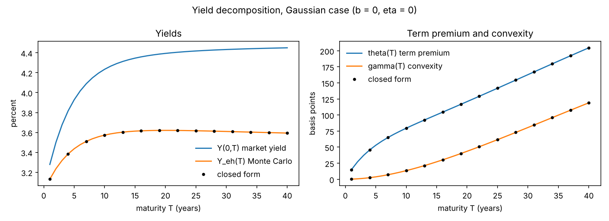

# slidingcurve

Term premia and bond convexity under sliding-curve dynamics, in JAX.

A working replication-in-progress of

> V. Piterbarg and W. Van Der Helm, *Term Premia and Bond Convexity: Sliding
> Curves, Trading Strategies, and Model Impact* (6 November 2026).

Equation numbers in the code refer to that paper. This is an independent
implementation written from the paper; it is not the authors' code.

## What works today

| Piece | Module | Status |
|---|---|---|
| Initial curve from one zero-yield function, forwards by autodiff | `curve.py` | tested |
| Linear Gaussian closed forms, Appendix D | `gaussian.py` | tested against eqs. (93), (94), (96) and D.5 |
| One-factor quasi-Gaussian simulator in the physical measure, eq. (52) | `model.py` | Gaussian case matches closed forms |
| Yield decomposition `Y = Y_eh + theta - gamma`, eqs. (12), (54), (55) | `decomposition.py` | closes within Monte-Carlo noise |
| Volatility scaling: zeroth order and bootstrap, eqs. (79)-(81) | `volscale.py` | tested, including its effect on at-the-money volatility |
| Payer swaption / caplet pricer in the expiry-forward measure | `pricing.py` | Gaussian case matches Jamshidian's exact price |
| Normal and displaced-lognormal quote conventions | `bachelier.py` | tested |
| Calibration of `sigma`, `b`, `eta` with an autodiff Jacobian | `calibration.py` | recovers known parameters; `eta` fit not validated |
| Test market: Joshi's displaced-diffusion LMM | `markets.py` | curve reprices the forwards exactly |
| Skew `b` and stochastic volatility `eta` | `model.py`, `pricing.py` | **validated by model-free identities only** |

Measured (Section 9.1 baseline: `delta = 5`, `kappa = 0.03`, monthly steps
for the decomposition, 24 steps a year for pricing):

- Gaussian decomposition: Monte Carlo and closed form agree to 0.01bp for
  `Y_eh`, `theta` and `gamma` at every maturity from 1 to 40 years.
- With skew and/or stochastic volatility on, the three independently estimated
  terms sum to the market yield to within their standard error.
- Gaussian swaption prices agree with the exact price to within Monte-Carlo
  error (about 0.05bp of normal volatility at 65,536 paths).
- Volatility scaling, 20y caplet on the 5y rate: moving `b` from 0 to 1 moves
  at-the-money volatility by about 10% with forward centring and by under 4%
  with the unweighted bootstrap. The bootstrap is the calibration default.



### End to end on a published test market

`examples/joshi_calibration.py` runs the Section 9.4 workflow on Mark Joshi's
displaced-diffusion LMM example (the kooderive set-up), with the 10y x 5y
swaption at five strikes. Fitting `sigma` and `b` matches all five normal
volatilities to under 0.1bp (`sigma = 1.79%`, `b = 0.52`).


This is **not** the paper's data. The market is a model with a pure
displaced-diffusion skew, its curve runs from 0.8% to 8.8% and stops at 20.5
years, and swaption quotes come from the frozen-weights approximation. It
exercises the machinery; it does not reproduce Figures 10-13.

## Not done yet

1. **Paper inputs.** The synthetic curve is given only as a plot, and the
   21-Aug-2026 USD swap curve and five 20y x 5y smile quotes are not
   tabulated. Until then Figures 2-13 can be matched in shape, not in level.
2. **A market with smile curvature.** Joshi's has none, so the `eta` fit is
   exercised but not meaningfully tested. Tables from Brigo and Mercurio could
   not be verified from a primary source and are not included;
   `markets.Quotes` and `Curve.from_zero_nodes` take them once typed in.
3. **Stochastic-volatility sweep at fixed at-the-money volatility** (Figures
   7-9) and the paper's figure scripts in general.
4. **Market-curve bootstrap** from swap quotes.
5. **Short-rate density** under P (Figure 13).
6. **Multi-factor model** (`d > 1`), the Ho-Lee checks of Appendix E, and the
   forward-rate decomposition of Appendix F.
7. Quasi-random numbers (Sobol with a Brownian bridge) and a GPU run.

## Choices the paper leaves open

These are assumptions of this implementation, to be revisited if the authors
clarify them:

- **Time stepping.** Monthly for the decomposition, 24 steps a year for pricing. `y` is advanced exactly for frozen
  volatility, and the drift of `x` is the increment that keeps the benchmark
  yield an exact discrete martingale; only the diffusion is Euler.
- **Variance process.** Full-truncation Euler.
- **Volatility cap** (Remark 8). Applied to `sigma_r` at 10x `sigma`; the
  local volatility is floored at zero.
- **Bootstrap grid** `T_m` for the volatility scaling: annual by default.
- **Calibration objective.** Price errors divided by normal vega, on fixed
  random numbers.

## Quick start

```bash
pip install -e ".[dev]"
pytest                                   # 41 tests, about a minute on CPU
python examples/gaussian_decomposition.py
python examples/joshi_calibration.py
```

```python
import jax, jax.numpy as jnp
from slidingcurve import Curve, Model, simulate, decompose, time_grid, volscale

curve = Curve.nelson_siegel(beta0=0.045, beta1=-0.015, beta2=0.01, tau=4.0)
model = Model(kappa=0.03, delta=5.0, sigma=0.01, b=0.25)
t = time_grid(40.0)
ybar = volscale.ybar_zeroth(curve, model.delta, t)
prof = simulate(model, curve, t, ybar, jax.random.PRNGKey(0))
dec = decompose(prof, model, curve, jnp.array([10.0, 30.0]))
print(dec.theta, dec.gamma, dec.residual)
```

## Design notes

- In the one-factor model `G(t, T)` is deterministic, so one simulation
  returns three mean profiles in time (`E[x]`, `E[mu^Y]`, `E[sigma_r^2]`) and
  every maturity's decomposition is a quadrature of those. No per-maturity
  resimulation.
- Paths are split into independent batches; standard errors of the integrated
  quantities are taken across batches.
- Float64 throughout: the quantities of interest are differences of yields at
  the 0.01bp level.

## Licence

None chosen yet. No code was copied from kooderive (GPL v3), so the choice is
open; importing its Sobol and Brownian-bridge modules later would make this
repository GPL v3 too.
