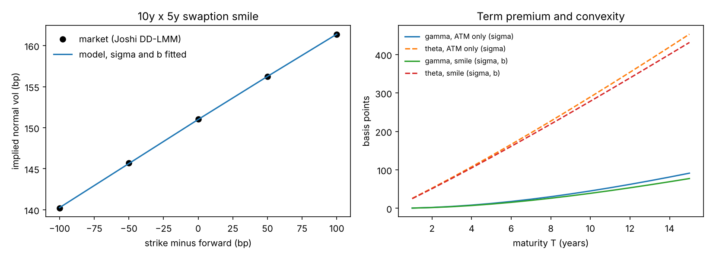
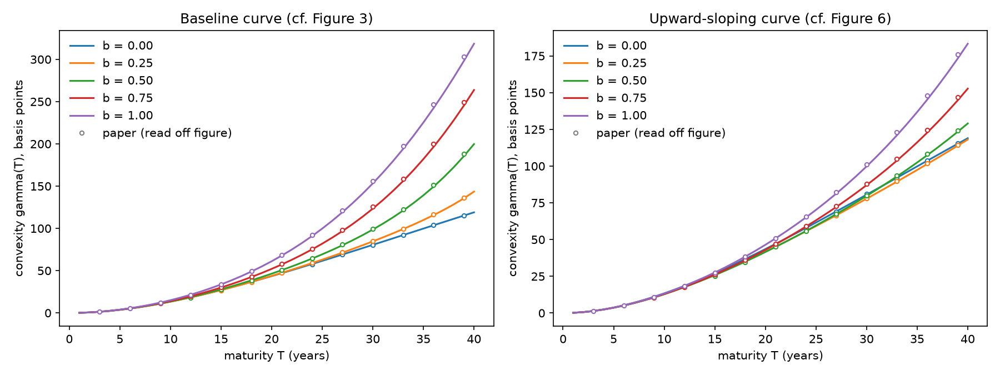
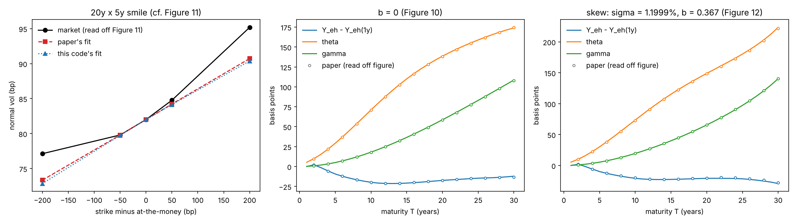

# slidingcurve

Term premia and bond convexity under sliding-curve dynamics, in JAX.

A working replication-in-progress of

> V. Piterbarg and W. Van Der Helm, *Term Premia and Bond Convexity: Sliding
> Curves, Trading Strategies, and Model Impact* (6 November 2026).

Equation numbers in the code refer to that paper. This is an independent
implementation written from the paper; it is not the authors' code.

## What works today

| Piece | Module | Status |
|---|---|---|
| Initial curve from one zero-yield function, forwards by autodiff | `curve.py` | tested |
| Linear Gaussian closed forms, Appendix D | `gaussian.py` | tested against eqs. (93), (94), (96) and D.5 |
| One-factor quasi-Gaussian simulator in the physical measure, eq. (52) | `model.py` | Gaussian case matches closed forms |
| Yield decomposition `Y = Y_eh + theta - gamma`, eqs. (12), (54), (55) | `decomposition.py` | closes within Monte-Carlo noise |
| Volatility scaling: zeroth order and bootstrap, eqs. (79)-(81) | `volscale.py` | tested, including its effect on at-the-money volatility |
| Payer swaption / caplet pricer in the expiry-forward measure | `pricing.py` | Gaussian case matches Jamshidian's exact price |
| Normal and displaced-lognormal quote conventions | `bachelier.py` | tested |
| Calibration of `sigma`, `b`, `eta` (autodiff Jacobian; finite differences for `eta`) | `calibration.py` | recovers known parameters; `eta` fit not validated |
| Test market: Joshi's displaced-diffusion LMM | `markets.py` | curve reprices the forwards exactly |
| The paper's curves, smile quotes and plotted results, digitised | `markets.py`, `data/` | reproduce Figures 2, 3, 5, 6, 10, 11, 12 (see below) |
| Options on the benchmark yield and calibration to their smile | `pricing.py`, `calibration.py` | reproduce the paper's `sigma` and skew fit |
| Skew `b` and stochastic volatility `eta` | `model.py`, `pricing.py` | **validated by model-free identities only** |

Measured (Section 9.1 baseline: `delta = 5`, `kappa = 0.03`, monthly steps
for the decomposition, 24 steps a year for pricing):

- Gaussian decomposition: Monte Carlo and closed form agree to 0.01bp for
  `Y_eh`, `theta` and `gamma` at every maturity from 1 to 40 years.
- With skew and/or stochastic volatility on, the three independently estimated
  terms sum to the market yield to within their standard error.
- Gaussian swaption prices agree with the exact price to within Monte-Carlo
  error (about 0.05bp of normal volatility at 65,536 paths).
- Volatility scaling, 20y caplet on the 5y rate: moving `b` from 0 to 1 moves
  at-the-money volatility by about 10% with forward centring and by under 4%
  with the unweighted bootstrap. The bootstrap is the calibration default.


### End to end on a published test market

`examples/joshi_calibration.py` runs the Section 9.4 workflow on Mark Joshi's
displaced-diffusion LMM example (the kooderive set-up), with the 10y x 5y
swaption at five strikes. Fitting `sigma` and `b` matches all five normal
volatilities to under 0.1bp (`sigma = 1.79%`, `b = 0.52`).



### Skew and convexity, against the paper's own results (Section 9.2)

The paper's two synthetic curves and its plotted results were read off the
figure images (`tools/digitise_figures.py`, accurate to a few tenths of a
basis point). On those curves, with the Section 9.1 settings and the
unweighted bootstrap scaling, `examples/skew_sweep.py` gives:



| Convexity at 40y | b = 0 | 0.25 | 0.5 | 0.75 | 1 |
|---|---|---|---|---|---|
| Baseline curve, this code | 119.0 | 144.2 | 201.1 | 264.8 | 318.8 |
| Baseline curve, paper (Figure 3) | 119.0 | 144.1 | 202.1 | 267.6 | 323.3 |
| Steep curve, this code | 119.0 | 117.7 | 128.1 | 150.8 | 180.1 |
| Steep curve, paper (Figure 6) | 119.5 | 118.4 | 129.9 | 154.9 | 186.3 |

The expectations-hypothesis yield of Figures 2 and 5 is matched to within
0.5bp at every maturity. Convexity is matched to within Monte-Carlo error
at low skew and falls 1-3% short of the paper at high skew and long maturity.
That shortfall is unexplained; candidates are the curve beyond 40 years
(extrapolated here), the bootstrap expiry grid and how the volatility cap is
applied. Forward-centred scaling gives 185bp instead of 320bp at `b = 1`, so
the bootstrap is what the paper's numbers require.

Figure 4 (smiles by skew) is not reproduced: it prices options on the yield
itself and the paper does not say in which measure or with which payment
date. For caplets on the 5y rate, `b = 1` moves the at-the-money price by
-0.5% at 5y expiry and +3.7% at 20y on the baseline curve.

### The market curve (Section 9.4, Figures 10-12)

The 21-Aug-2026 USD curve, the five 20y x 5y smile quotes and the paper's
results were also read off the figures. `examples/market_curve.py`:



| | this code | paper |
|---|---|---|
| `sigma` for an 82bp at-the-money vol, `b = 0` | 1.157% | 1.157% |
| Figure 10 at 20y: `Y_eh`, `theta`, `gamma` | 372.6, 138.0, 58.3bp | 372.6, 138.0, 58.3bp |
| Skew fit: `sigma`, `b` | 1.19%, 0.35 | 1.1999%, 0.367 |
| Skew fit vols at -200, -50, 0, +50, +200bp | 72.9, 79.7, 82.0, 84.1, 90.4 | 73.3, 79.8, 82.0, 84.2, 90.7 |
| Figure 12 `gamma` at 30y, paper's parameters | 140.5bp | 140.3bp |
| Figure 12 `gamma` at 30y, this code's fit | 136.6bp | 140.3bp |

Three things to know:

- **The paper states two values of `sigma` for the skew fit**: 1.12% in the
  text of Section 9.4 and 1.1999% in the caption of Figure 13. Only 1.1999%
  reproduces Figure 12 and the fitted smile of Figure 11.
- **The "yield option" is not defined in the paper.** The reading used here
  (see `pricing.yield_option_prices`) was chosen because it reproduces
  `sigma = 1.157%`; that the same reading then reproduces the skew fit and
  Figure 12 is the evidence for it.
- **The fit differs slightly from the paper's** (`b` 0.35 against 0.367).
  The quotes are read off a plot to about 0.3bp and the paper does not state
  its fitting weights; here the at-the-money quote is pinned and the rest are
  equally weighted. At 30 years, where the curve beyond the plotted range is
  extrapolated, `Y_eh` and `theta` are within 2bp.

The three-parameter fit including `eta` does **not** converge in this code
(the paper reports `sigma = 1.492%`, `b = 0.417`, `eta = 0.779`, and itself
rejects the resulting decomposition).

### Stochastic volatility and convexity (Section 9.3)

`examples/stochvol_sweep.py` produces the analogues of Figures 7-9 on an
illustrative curve (with `b = 0` convexity does not depend on the curve) (about five minutes on a CPU at the default 131,072 paths).


| eta | 20y x 5y ATM vol, sigma fixed | sigma recalibrated to ATM | convexity vs eta = 0 |
|---|---|---|---|
| 0 | 88.8bp | 1.000% | 1.00 |
| 0.5 | 83.8bp | 1.059% | 1.12 |
| 1.0 | 74.8bp | 1.188% | 1.41 |
| 1.5 | 66.7bp | 1.336% | 1.78 |

The paper's three qualitative findings are reproduced: at fixed `sigma`
convexity does not move with `eta`; at-the-money volatility falls as `eta`
rises; and holding at-the-money volatility fixed raises convexity. One number
can be compared directly: Section 8.2 quotes an uplift of about 15%, 16% and
17.5% for `eta = 0.6` over ten years at `kappa = 0`, `0.03` and `0.05`; this
code gives 13.4%, 15.1% and 16.4%. The levels in the figure are not
comparable with the paper's, since the curve differs.

This is **not** the paper's data. The market is a model with a pure
displaced-diffusion skew, its curve runs from 0.8% to 8.8% and stops at 20.5
years, and swaption quotes come from the frozen-weights approximation. It
exercises the machinery; it does not reproduce Figures 10-13.

## Not done yet

1. **The three-parameter fit** (`sigma`, `b`, `eta` together) does not
   converge; the loop that rebuilds the volatility scaling as `sigma` moves
   is the suspect.
2. **A market with smile curvature.** Joshi's has none, so the `eta` fit is
   exercised but not meaningfully tested. Tables from Brigo and Mercurio could
   not be verified from a primary source and are not included;
   `markets.Quotes` and `Curve.from_zero_nodes` take them once typed in.
3. **Figure 4** (see above), and Figures 7-9 compared point by point with the
   paper's plots.
4. **Market-curve bootstrap** from swap quotes.
5. **Short-rate density** under P (Figure 13); it is now within reach.
6. **Multi-factor model** (`d > 1`), the Ho-Lee checks of Appendix E, and the
   forward-rate decomposition of Appendix F.
7. Quasi-random numbers (Sobol with a Brownian bridge) and a GPU run.

## Choices the paper leaves open

These are assumptions of this implementation, to be revisited if the authors
clarify them:

- **Time stepping.** Monthly for the decomposition, 24 steps a year for pricing. `y` is advanced exactly for frozen
  volatility, and the drift of `x` is the increment that keeps the benchmark
  yield an exact discrete martingale; only the diffusion is Euler.
- **Variance process.** Andersen's quadratic-exponential scheme (full-truncation
  Euler lost up to 4% of `E[z]` at `eta = 1.5`).
- **Volatility cap** (Remark 8). Applied to `sigma_r` at 10x `sigma`; the
  local volatility is floored at zero.
- **Bootstrap grid** `T_m` for the volatility scaling: annual by default.
- **Synthetic curves.** Splines through yields read off Figures 2 and 5,
  extended quadratically from 40 to 45 years.
- **Calibration objective.** Price errors divided by normal vega, on fixed
  random numbers.

## Quick start

```bash
pip install -e ".[dev]"
pytest                                   # 53 tests, about four minutes on CPU
python examples/gaussian_decomposition.py
python examples/joshi_calibration.py
python examples/skew_sweep.py
python examples/market_curve.py          # about five minutes
python examples/stochvol_sweep.py
```

```python
import jax, jax.numpy as jnp
from slidingcurve import Curve, Model, simulate, decompose, time_grid, volscale

curve = Curve.nelson_siegel(beta0=0.045, beta1=-0.015, beta2=0.01, tau=4.0)
model = Model(kappa=0.03, delta=5.0, sigma=0.01, b=0.25)
t = time_grid(40.0)
ybar = volscale.ybar_zeroth(curve, model.delta, t)
prof = simulate(model, curve, t, ybar, jax.random.PRNGKey(0))
dec = decompose(prof, model, curve, jnp.array([10.0, 30.0]))
print(dec.theta, dec.gamma, dec.residual)
```

## Design notes

- In the one-factor model `G(t, T)` is deterministic, so one simulation
  returns three mean profiles in time (`E[x]`, `E[mu^Y]`, `E[sigma_r^2]`) and
  every maturity's decomposition is a quadrature of those. No per-maturity
  resimulation.
- Paths are split into independent batches; standard errors of the integrated
  quantities are taken across batches.
- Float64 throughout: the quantities of interest are differences of yields at
  the 0.01bp level.

## Licence

None chosen yet. No code was copied from kooderive (GPL v3), so the choice is
open; importing its Sobol and Brownian-bridge modules later would make this
repository GPL v3 too.
