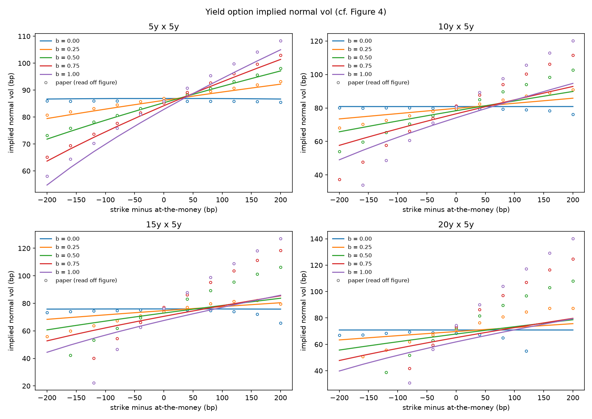

# slidingcurve

Term premia and bond convexity under sliding-curve dynamics, in JAX.

A working replication-in-progress of

> V. Piterbarg and W. Van Der Helm, *Term Premia and Bond Convexity: Sliding
> Curves, Trading Strategies, and Model Impact* (6 November 2026).

Equation numbers in the code refer to that paper. This is an independent
implementation written from the paper; it is not the authors' code.

## What works today

| Piece | Module | Status |
|---|---|---|
| Initial curve from one zero-yield function, forwards by autodiff | `curve.py` | tested |
| Linear Gaussian closed forms, Appendix D | `gaussian.py` | tested against eqs. (93), (94), (96) and D.5 |
| One-factor quasi-Gaussian simulator in the physical measure, eq. (52) | `model.py` | Gaussian case matches closed forms |
| Yield decomposition `Y = Y_eh + theta - gamma`, eqs. (12), (54), (55) | `decomposition.py` | closes within Monte-Carlo noise |
| Volatility scaling: zeroth order and bootstrap, eqs. (79)-(81) | `volscale.py` | tested, including its effect on at-the-money volatility |
| Payer swaption / caplet pricer in the expiry-forward measure | `pricing.py` | Gaussian case matches Jamshidian's exact price |
| Normal and displaced-lognormal quote conventions | `bachelier.py` | tested |
| Calibration of `sigma`, `b`, `eta` (autodiff Jacobian, scaling rebuilt inside the objective; finite differences for `eta`) | `calibration.py` | recovers known parameters; reproduces the paper's `sigma` and skew fit |
| Test market: Joshi's displaced-diffusion LMM | `markets.py` | curve reprices the forwards exactly |
| The paper's curves, smile quotes and plotted results, digitised | `markets.py`, `data/` | reproduce Figures 2, 3, 5-13 except 4 (see below) |
| Options on the benchmark yield and calibration to their smile | `pricing.py`, `calibration.py` | reproduce the paper's `sigma` and skew fit |
| Skew `b` and stochastic volatility `eta` | `model.py`, `pricing.py` | **validated by model-free identities only** |
| Multi-factor quasi-Gaussian model (d > 1), Sections 5-6, and the general bootstrap of Appendix C.3.2 | `multifactor.py` | Gaussian case matches closed forms; d = 1 is the one-factor model |

Measured (Section 9.1 baseline: `delta = 5`, `kappa = 0.03`, monthly steps
for the decomposition, 24 steps a year for pricing):

- Gaussian decomposition on the paper's baseline curve: Monte Carlo and
  closed form agree to 0.002bp, and the closed forms reproduce all four
  series of Figure 2 to 0.24bp (digitisation error) at every maturity from
  1 to 40 years.
- With skew and/or stochastic volatility on, the three independently estimated
  terms sum to the market yield to within their standard error.
- Gaussian swaption prices agree with the exact price to within Monte-Carlo
  error (about 0.05bp of normal volatility at 65,536 paths).
- Yield options can be priced with a Gaussian-twin control variate
  (`control_variate=True`): exact in the Gaussian case, so `sigma` for the
  82bp at-the-money vol is 1.1572% at any seed and path count (plain: +-0.01%
  at 32,768 paths), and variance cut 14-28x at the market skew (B4).
- Volatility scaling, 20y caplet on the 5y rate: moving `b` from 0 to 1 moves
  at-the-money volatility by about 10% with forward centring and by under 4%
  with the unweighted bootstrap. The bootstrap is the calibration default.


### End to end on a published test market

`examples/joshi_calibration.py` runs the Section 9.4 workflow on Mark Joshi's
displaced-diffusion LMM example (the kooderive set-up), with the 10y x 5y
swaption at five strikes. Fitting `sigma` and `b` matches all five normal
volatilities to under 0.1bp (`sigma = 1.83%`, `b = 0.53`).


This is **not** the paper's data. The market is a model with a pure
displaced-diffusion skew, its curve runs from 0.8% to 8.8% and stops at 20.5
years, and swaption quotes come from the frozen-weights approximation. It
exercises the machinery; it does not reproduce Figures 10-13.

### Skew and convexity, against the paper's own results (Section 9.2)

The paper's two synthetic curves and its plotted results were read off the
figure images (`tools/digitise_figures.py`, accurate to a few tenths of a
basis point). On those curves, with the Section 9.1 settings and the
unweighted bootstrap scaling on a monthly expiry grid,
`examples/skew_sweep.py` gives:


| Convexity at 40y | b = 0 | 0.25 | 0.5 | 0.75 | 1 |
|---|---|---|---|---|---|
| Baseline curve, this code | 119.0 | 143.5 | 199.8 | 263.7 | 318.5 |
| Baseline curve, paper (Figure 3) | 119.0 | 144.1 | 202.1 | 267.6 | 323.3 |
| Steep curve, this code | 119.0 | 118.1 | 129.0 | 152.7 | 183.3 |
| Steep curve, paper (Figure 6) | 119.5 | 118.4 | 129.9 | 154.9 | 186.3 |

The expectations-hypothesis yield of Figures 2 and 5 is matched to within
0.5bp at every maturity. Convexity is matched to within Monte-Carlo error
at low skew and falls 1.7-2.6% short of the paper at `b >= 0.5` and 40
years (precise runs: 317.2 +- 0.9 against 323.3 at `b = 1`; A2). Part of the
earlier shortfall was numerical: the bootstrap (81) discretises (80) with a
first-order error in its expiry grid, and the annual grid used before was
3.4bp off on the steep curve at `b = 1`; the default grid is now monthly
(within 0.2bp of converged). The rest sits inside the sensitivity to the
volatility cap of Remark 8, which binds at high skew even without
stochastic volatility: at `b = 1`, moving the cap from 10x to 12x moves
`gamma(40y)` by 26bp. The paper does not define the cap precisely enough to
go further. The time step, the curve beyond 40 years and the volatility
floor were ruled out. Forward-centred scaling gives 185bp instead of 320bp at
`b = 1`, so the bootstrap is what the paper's numbers require.

**Figure 4 (smiles by skew) is not reproduced**, and appears to be
inconsistent with the rest of the paper. `examples/skew_smiles.py` prices the
same yield options that reproduce Section 9.4:



- At the 5y expiry the smile slopes agree. At 10-20y the paper's plotted
  smiles are up to four times steeper than this code's, and its
  at-the-money vol rises with `b` where this code's falls.
- The paper's *text* says at-the-money vol at `b = 1` is about 4bp below its
  `b = 0` value at 5y and 6-8bp below at 20y. This code gives 4.6bp and 9bp:
  it agrees with the text, which Figure 4 itself contradicts.
- Figure 4's `b = 0` smile at 20y droops from 68bp to 55bp, while Figure 8
  shows the same option at `b = 0`, `eta = 0` flat at 71.4bp.

- At `b = 0` the option is Gaussian in every measure, yet Figure 4's 15-20y
  `b = 0` smiles are flat and then fall off a cliff, losing points half a
  standard deviation from the money. No measure, numeraire, inversion
  forward or call/put convention produces that (A1).

Every reading of the option and every scaling and local-volatility variant
was tried (`docs/investigation.md`, A1); none moves the 20y `b = 1` slope off
25bp against the paper's 110bp. Figure 4 is recorded as an inconsistency in
the paper and put to the authors (`docs/questions_for_authors.md`).

### The market curve (Section 9.4, Figures 10-12)

The 21-Aug-2026 USD curve, the five 20y x 5y smile quotes and the paper's
results were also read off the figures. `examples/market_curve.py`:


| | this code | paper |
|---|---|---|
| `sigma` for an 82bp at-the-money vol, `b = 0` | 1.157% | 1.157% |
| Figure 10 at 20y: `Y_eh`, `theta`, `gamma` | 372.6, 138.0, 58.3bp | 372.6, 138.0, 58.3bp |
| Skew fit: `sigma`, `b` | 1.196%, 0.354 | 1.1999%, 0.367 |
| Skew fit vols at -200, -50, 0, +50, +200bp | 72.9, 79.8, 82.0, 84.2, 90.4 | 73.3, 79.8, 82.0, 84.2, 90.7 |
| Figure 12 `gamma` at 30y, paper's parameters | 140.1bp | 140.3bp |
| Figure 12 `gamma` at 30y, this code's fit | 136.8bp | 140.3bp |

Three things to know:

- **The paper states two values of `sigma` for the skew fit**: 1.12% in the
  text of Section 9.4 and 1.1999% in the caption of Figure 13. Only 1.1999%
  reproduces Figure 12 (`gamma(30y)` 140.5 against 140.3bp; 1.12% gives
  115.6) and the paper's fitted smile of Figure 11 (to 0.7bp; 1.12% misses by
  3-5bp under any reading of the option). The text's value is a typo or a
  leftover (A10).
- **The "yield option" is not defined in the paper.** Its numbers pin it
  down (`docs/investigation.md`, A9): the underlying is the continuously
  compounded forward yield (the only one that gives `sigma = 1.1572%`), paid
  at the end of its window (the only payment date that reproduces the
  paper's own Figure 11 fit at its stated parameters), with vols inverted
  around the yield's mean in that measure. Whether strikes are offsets from
  that mean or from the curve forward is not determined: Figure 11 favours
  the mean, Figure 8 the forward. `strike_reference=` offers both; the
  default is the mean.
- **The fit differs slightly from the paper's** (`b` 0.353 against 0.367).
  The paper's own parameters reproduce its plotted fit in this code to
  0.7bp, so the engine agrees; the fit is what moves. Five quotes fix a
  valley in (`sigma`, `b`) along which `gamma(30y)` moves about 10bp per
  basis point of smile level, and over pricing seeds a single fit scatters
  by 0.0055% in `sigma`, 0.0027 in `b` and 1.7bp in `gamma(30y)` at 65,536
  paths (A6). The paper does not state its weights or path count; here the
  at-the-money quote is pinned, since the paper says it is matched exactly.
- **At the end of the plotted range** (30 years on the market curve, 40 on
  the synthetic ones) `Y_eh` and `theta` depend on forwards up to five years
  further out, which no figure shows. Reasonable extensions move `Y_eh(30y)`
  between 370 and 378bp and `theta` by the same amount the other way; the
  paper's values lie inside that band, 1.5bp from this code's quadratic
  extension. Convexity is unaffected (A8).

The three-parameter fit including `eta` is not identified by five quotes at
Monte-Carlo precision (A7). Profiling `eta` (refitting `sigma` and `b` at
each value) the rms error falls monotonically from 2.87bp at `eta = 0` to
1.30bp at 1.6, and beyond 0.8 by less than one quote's pricing s.e. (about
1.3bp), so where a fit stops is set by its random numbers. The paper's point
(1.492%, 0.417, 0.779) and this code's earlier one (1.80%, 0.36, 1.39) lie
on the same valley, along which `gamma(30y)` runs from 137 to 464bp (316 at
the paper's point). The "spurious basin" above `sigma = 2.5%` is the same
valley at larger `eta`. This is the paper's own conclusion in other words.

**Figure 13** (short-rate densities under P, `examples/short_rate_density.py`):


| r(30y) | this code | paper |
|---|---|---|
| Standard deviation, no skew | 638bp | "over 600bp" |
| Probability negative, no skew | 0.27 | "around one in four" |
| Median, with skew | 26bp | "around zero" |
| Probability negative, with skew | 0.47 | "about one half" |
| Mean, with skew | 282bp | 280bp |

### Stochastic volatility and convexity (Section 9.3, Figures 7-9)

`examples/stochvol_sweep.py`, on the paper's baseline curve with the 20y x 5y
yield option as the benchmark:


| eta | ATM vol at fixed sigma: this code / paper | Convexity at 40y, ATM vol fixed: this code / paper |
|---|---|---|
| 0 | 70.9 / 71.4bp | 119.0 / 119.2bp |
| 0.5 | 66.8 / 66.1bp | 133.7 / 133.6bp |
| 1.0 | 59.9 / 60.9bp | 165.5 / 166.7bp |
| 1.5 | 53.8 / 53.6bp | 202.7 / 212.8bp |

Figure 7 (convexity unchanged by `eta` at fixed `sigma`) is reproduced.
Figure 9 is matched to within 1% up to `eta = 1`; at `eta = 1.5` this code
gives 204.2 +- 1.3bp (four pricing seeds) against 212.8 (A3). The gap is not
the volatility cap (it never binds at `b = 0`), the time step, or the
variance scheme (quadratic-exponential agrees with exact CIR sampling to
0.1bp of at-the-money vol), and recalibrating to the paper's 71.5bp breaks
`eta = 0.5`. The paper's ratios are not squared at-the-money vol ratios
either (that hypothesis fails at `eta = 0.5`). What remains is sampling
noise in the paper's run, which only its path count can confirm.

Figure 8's smiles agree to 0.4-1.5bp, and on a common axis of absolute
strikes their minima coincide (about 400bp; the smile above plots both
against absolute strike). An earlier version of this comparison set this
code's offsets from the yield's mean (364bp) against the paper's offsets
from the forward (387bp), which made the minimum appear 50bp to the right
(A4). The paper's `eta = 0` level, 71.4bp (71.5 in its text), is 0.55bp
above the exact Gaussian value of 70.86bp and its line is tilted, which a
Gaussian smile cannot be under any pricing convention: it looks like the
sampling error of a run with a few thousand paths.

Section 8.2 quotes an uplift of about 15%, 16% and 17.5% for `eta = 0.6`
over ten years at `kappa = 0`, `0.03` and `0.05`. Those are exactly the
Jensen ratio `E(V) / E(sqrt V)^2` of a driftless rate on the CIR clock
(14.5%, 16.3%, 17.5%; A5). The full model gives 0.6-0.7 points less (13.85
+- 0.07% at `kappa = 0`), because the benchmark yield's forward-measure
drift is itself driven by the realised variance; made driftless, the model
reproduces the Jensen ratio to 0.1 points.

## Not done yet

1. **Figure 4** is not reproduced and is inconsistent with the paper's text
   and its Figure 8 (A1); it needs the authors' input.
2. **Convexity at high skew or high vol-of-vol** is 1.7-2.6% (skew) and 4%
   (`eta = 1.5`) below the paper at the longest maturities. The skew gap is
   inside the sensitivity to the volatility cap (A2); the vol-of-vol gap is
   most plausibly the paper's own sampling noise (A3). Both need the
   authors' input.
3. **A second smile market.** Tables from Brigo and Mercurio could not be
   verified from a primary source and are not included; `markets.Quotes` and
   `Curve.from_zero_nodes` take them once typed in.
4. **Market-curve bootstrap** from swap quotes.
5. **Multi-factor model** (`d > 1`), the Ho-Lee checks of Appendix E, and the
   forward-rate decomposition of Appendix F.
6. Quasi-random numbers (Sobol with a Brownian bridge) and a GPU run.

## Choices the paper leaves open

These are assumptions of this implementation, to be revisited if the authors
clarify them:

- **Time stepping.** Monthly for the decomposition, 24 steps a year for pricing. `y` is advanced exactly for frozen
  volatility, and the drift of `x` is the increment that keeps the benchmark
  yield an exact discrete martingale; only the diffusion is Euler.
- **Variance process.** Andersen's quadratic-exponential scheme (full-truncation
  Euler lost up to 4% of `E[z]` at `eta = 1.5`); it agrees with exact CIR
  sampling to 0.1bp of at-the-money vol. `variance_scheme="lognormal"` is a
  moment-matched alternative that is smooth in `eta`, so calibrations with
  `eta` free use autodiff instead of finite differences (B1).
- **Volatility cap** (Remark 8). Applied to `sigma_r` at 10x `sigma`; the
  local volatility is floored at zero. At `b >= 0.5` the cap binds and
  convexity at 40 years depends on its level (A2); the paper's definition
  is not precise enough to pin it down.
- **Bootstrap grid** `T_m` for the volatility scaling: monthly
  (`volscale.bootstrap_grid`), where (81) is converged; annual is not (A2).
- **Synthetic curves.** Splines through yields read off Figures 2 and 5,
  extended quadratically from 40 to 45 years.
- **Calibration objective.** Price errors divided by normal vega, on fixed
  random numbers.

## Quick start

Monte-Carlo pricing can use every CPU core: start Python with
`XLA_FLAGS=--xla_force_host_platform_device_count=16` (or your core count)
and call `slidingcurve.pricing.set_path_devices()`. A (sigma, b) smile fit
then takes about 4s instead of 21s (B2); results change within Monte-Carlo
error, since each device draws its own random numbers.

```bash
pip install -e ".[dev]"
pytest                                   # 57 tests, about three minutes on CPU
python examples/gaussian_decomposition.py
python examples/joshi_calibration.py
python examples/skew_sweep.py
python examples/skew_smiles.py
python examples/short_rate_density.py
python examples/market_curve.py          # about five minutes
python examples/stochvol_sweep.py
```

```python
import jax, jax.numpy as jnp
from slidingcurve import Curve, Model, simulate, decompose, time_grid, volscale

curve = Curve.nelson_siegel(beta0=0.045, beta1=-0.015, beta2=0.01, tau=4.0)
model = Model(kappa=0.03, delta=5.0, sigma=0.01, b=0.25)
t = time_grid(40.0)
ybar = volscale.ybar_zeroth(curve, model.delta, t)
prof = simulate(model, curve, t, ybar, jax.random.PRNGKey(0))
dec = decompose(prof, model, curve, jnp.array([10.0, 30.0]))
print(dec.theta, dec.gamma, dec.residual)
```

## Design notes

- In the one-factor model `G(t, T)` is deterministic, so one simulation
  returns three mean profiles in time (`E[x]`, `E[mu^Y]`, `E[sigma_r^2]`) and
  every maturity's decomposition is a quadrature of those. No per-maturity
  resimulation.
- Paths are split into independent batches; standard errors of the integrated
  quantities are taken across batches.
- Float64 throughout: the quantities of interest are differences of yields at
  the 0.01bp level.

## Licence

None chosen yet; the choice is the copyright holder's. No code was copied
from kooderive (GPL v3), so it is open. The options and what each implies
here (permissive MIT/BSD/Apache 2.0, file-level MPL 2.0, LGPL/GPL/AGPL v3,
and the status quo of no licence), together with the separate question of
the digitised figure data, are set out in `docs/investigation.md` (B5).
Importing kooderive's Sobol and Brownian-bridge modules later would require
GPL v3.
