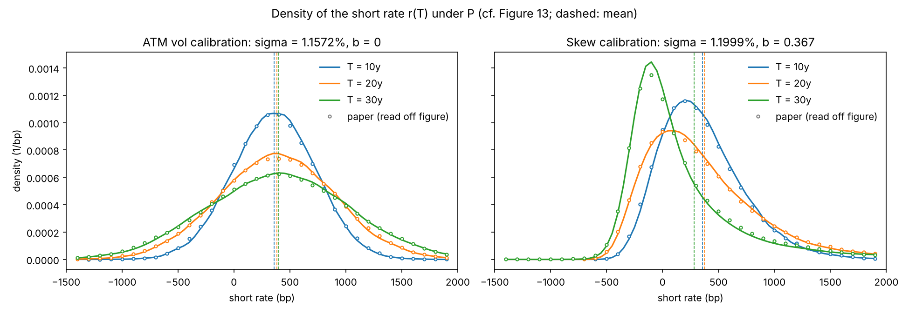
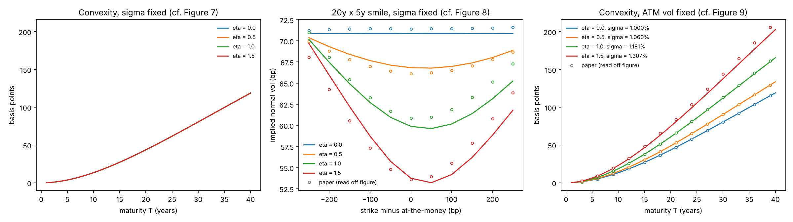

# slidingcurve

Term premia and bond convexity under sliding-curve dynamics, in JAX.

A working replication-in-progress of

> V. Piterbarg and W. Van Der Helm, *Term Premia and Bond Convexity: Sliding
> Curves, Trading Strategies, and Model Impact* (6 November 2026).

Equation numbers in the code refer to that paper. This is an independent
implementation written from the paper; it is not the authors' code.

## What works today

| Piece | Module | Status |
|---|---|---|
| Initial curve from one zero-yield function, forwards by autodiff | `curve.py` | tested |
| Linear Gaussian closed forms, Appendix D | `gaussian.py` | tested against eqs. (93), (94), (96) and D.5 |
| One-factor quasi-Gaussian simulator in the physical measure, eq. (52) | `model.py` | Gaussian case matches closed forms |
| Yield decomposition `Y = Y_eh + theta - gamma`, eqs. (12), (54), (55) | `decomposition.py` | closes within Monte-Carlo noise |
| Volatility scaling: zeroth order and bootstrap, eqs. (79)-(81) | `volscale.py` | tested, including its effect on at-the-money volatility |
| Payer swaption / caplet pricer in the expiry-forward measure | `pricing.py` | Gaussian case matches Jamshidian's exact price |
| Normal and displaced-lognormal quote conventions | `bachelier.py` | tested |
| Calibration of `sigma`, `b`, `eta` (autodiff Jacobian, scaling rebuilt inside the objective; finite differences for `eta`) | `calibration.py` | recovers known parameters; reproduces the paper's `sigma` and skew fit |
| Test market: Joshi's displaced-diffusion LMM | `markets.py` | curve reprices the forwards exactly |
| The paper's curves, smile quotes and plotted results, digitised | `markets.py`, `data/` | reproduce Figures 2, 3, 5-13 except 4 (see below) |
| Options on the benchmark yield and calibration to their smile | `pricing.py`, `calibration.py` | reproduce the paper's `sigma` and skew fit |
| Skew `b` and stochastic volatility `eta` | `model.py`, `pricing.py` | **validated by model-free identities only** |

Measured (Section 9.1 baseline: `delta = 5`, `kappa = 0.03`, monthly steps
for the decomposition, 24 steps a year for pricing):

- Gaussian decomposition: Monte Carlo and closed form agree to 0.01bp for
  `Y_eh`, `theta` and `gamma` at every maturity from 1 to 40 years.
- With skew and/or stochastic volatility on, the three independently estimated
  terms sum to the market yield to within their standard error.
- Gaussian swaption prices agree with the exact price to within Monte-Carlo
  error (about 0.05bp of normal volatility at 65,536 paths).
- Volatility scaling, 20y caplet on the 5y rate: moving `b` from 0 to 1 moves
  at-the-money volatility by about 10% with forward centring and by under 4%
  with the unweighted bootstrap. The bootstrap is the calibration default.


### End to end on a published test market

`examples/joshi_calibration.py` runs the Section 9.4 workflow on Mark Joshi's
displaced-diffusion LMM example (the kooderive set-up), with the 10y x 5y
swaption at five strikes. Fitting `sigma` and `b` matches all five normal
volatilities to under 0.1bp (`sigma = 1.83%`, `b = 0.53`).


This is **not** the paper's data. The market is a model with a pure
displaced-diffusion skew, its curve runs from 0.8% to 8.8% and stops at 20.5
years, and swaption quotes come from the frozen-weights approximation. It
exercises the machinery; it does not reproduce Figures 10-13.

### Skew and convexity, against the paper's own results (Section 9.2)

The paper's two synthetic curves and its plotted results were read off the
figure images (`tools/digitise_figures.py`, accurate to a few tenths of a
basis point). On those curves, with the Section 9.1 settings and the
unweighted bootstrap scaling, `examples/skew_sweep.py` gives:


| Convexity at 40y | b = 0 | 0.25 | 0.5 | 0.75 | 1 |
|---|---|---|---|---|---|
| Baseline curve, this code | 119.0 | 144.2 | 201.1 | 264.8 | 318.8 |
| Baseline curve, paper (Figure 3) | 119.0 | 144.1 | 202.1 | 267.6 | 323.3 |
| Steep curve, this code | 119.0 | 117.7 | 128.1 | 150.8 | 180.1 |
| Steep curve, paper (Figure 6) | 119.5 | 118.4 | 129.9 | 154.9 | 186.3 |

The expectations-hypothesis yield of Figures 2 and 5 is matched to within
0.5bp at every maturity. Convexity is matched to within Monte-Carlo error
at low skew and falls 1-3% short of the paper at high skew and long maturity.
That shortfall is unexplained; candidates are the curve beyond 40 years
(extrapolated here), the bootstrap expiry grid and how the volatility cap is
applied. Forward-centred scaling gives 185bp instead of 320bp at `b = 1`, so
the bootstrap is what the paper's numbers require.

**Figure 4 (smiles by skew) is not reproduced**, and appears to be
inconsistent with the rest of the paper. `examples/skew_smiles.py` prices the
same yield options that reproduce Section 9.4:


- At the 5y expiry the smile slopes agree. At 10-20y the paper's plotted
  smiles are up to four times steeper than this code's, and its
  at-the-money vol rises with `b` where this code's falls.
- The paper's *text* says at-the-money vol at `b = 1` is about 4bp below its
  `b = 0` value at 5y and 6-8bp below at 20y. This code gives 4.6bp and 9bp:
  it agrees with the text, which Figure 4 itself contradicts.
- Figure 4's `b = 0` smile at 20y droops from 68bp to 55bp, while Figure 8
  shows the same option at `b = 0`, `eta = 0` flat at 71.4bp.

So Figure 4 may come from a different version of the authors' pricer; only
they can say.

### The market curve (Section 9.4, Figures 10-12)

The 21-Aug-2026 USD curve, the five 20y x 5y smile quotes and the paper's
results were also read off the figures. `examples/market_curve.py`:


| | this code | paper |
|---|---|---|
| `sigma` for an 82bp at-the-money vol, `b = 0` | 1.157% | 1.157% |
| Figure 10 at 20y: `Y_eh`, `theta`, `gamma` | 372.6, 138.0, 58.3bp | 372.6, 138.0, 58.3bp |
| Skew fit: `sigma`, `b` | 1.19%, 0.35 | 1.1999%, 0.367 |
| Skew fit vols at -200, -50, 0, +50, +200bp | 72.9, 79.7, 82.0, 84.1, 90.4 | 73.3, 79.8, 82.0, 84.2, 90.7 |
| Figure 12 `gamma` at 30y, paper's parameters | 140.5bp | 140.3bp |
| Figure 12 `gamma` at 30y, this code's fit | 136.6bp | 140.3bp |

Three things to know:

- **The paper states two values of `sigma` for the skew fit**: 1.12% in the
  text of Section 9.4 and 1.1999% in the caption of Figure 13. Only 1.1999%
  reproduces Figure 12 (`gamma(30y)` 140.5 against 140.3bp; 1.12% gives
  115.6) and the paper's fitted smile of Figure 11 (to 0.7bp; 1.12% misses by
  3-5bp under any reading of the option). The text's value is a typo or a
  leftover (A10).
- **The "yield option" is not defined in the paper.** Its numbers pin it
  down (`docs/investigation.md`, A9): the underlying is the continuously
  compounded forward yield (the only one that gives `sigma = 1.1572%`), paid
  at the end of its window (the only payment date that reproduces the
  paper's own Figure 11 fit at its stated parameters), with vols inverted
  around the yield's mean in that measure. Whether strikes are offsets from
  that mean or from the curve forward is not determined: Figure 11 favours
  the mean, Figure 8 the forward. `strike_reference=` offers both; the
  default is the mean.
- **The fit differs slightly from the paper's** (`b` 0.35 against 0.367).
  The quotes are read off a plot to about 0.3bp and the paper does not state
  its fitting weights; here the at-the-money quote is pinned and the rest are
  equally weighted.
- **At the end of the plotted range** (30 years on the market curve, 40 on
  the synthetic ones) `Y_eh` and `theta` depend on forwards up to five years
  further out, which no figure shows. Reasonable extensions move `Y_eh(30y)`
  between 370 and 378bp and `theta` by the same amount the other way; the
  paper's values lie inside that band, 1.5bp from this code's quadratic
  extension. Convexity is unaffected (A8).

The three-parameter fit including `eta` converges, to `sigma = 1.80%`,
`b = 0.36`, `eta = 1.39` with errors under 1.5bp, not to the paper's
`1.492%`, `0.417`, `0.779`. At the paper's parameters this code's smile is
within 2.6bp of the market, so both are acceptable fits: `sigma` and `eta`
trade off along a flat valley and are weakly identified by five quotes. (A
second, spurious basin exists above `sigma = 2.5%` where the volatility cap
does the work; the paper itself rejects the three-parameter decomposition.)

**Figure 13** (short-rate densities under P, `examples/short_rate_density.py`):



| r(30y) | this code | paper |
|---|---|---|
| Standard deviation, no skew | 638bp | "over 600bp" |
| Probability negative, no skew | 0.27 | "around one in four" |
| Median, with skew | 13bp | "around zero" |
| Probability negative, with skew | 0.48 | "about one half" |
| Mean, with skew | 281bp | 280bp |

### Stochastic volatility and convexity (Section 9.3, Figures 7-9)

`examples/stochvol_sweep.py`, on the paper's baseline curve with the 20y x 5y
yield option as the benchmark:



| eta | ATM vol at fixed sigma: this code / paper | Convexity at 40y, ATM vol fixed: this code / paper |
|---|---|---|
| 0 | 70.9 / 71.4bp | 119.0 / 119.2bp |
| 0.5 | 66.8 / 66.1bp | 133.7 / 133.6bp |
| 1.0 | 59.9 / 60.9bp | 165.5 / 166.7bp |
| 1.5 | 53.8 / 53.6bp | 202.7 / 212.8bp |

Figure 7 (convexity unchanged by `eta` at fixed `sigma`) is reproduced.
Figure 9 is matched to within 1% up to `eta = 1` and is 5% low at
`eta = 1.5`. The paper's convexity ratios equal the squared ratios of its
at-the-money vols, as if `sigma` were rescaled linearly; here `sigma` is
recalibrated on the simulated option, which is not exactly linear because the
convexity state `y` is random under stochastic volatility. The paper's
`eta = 0` level of 71.4bp is also 0.7% above the Gaussian closed form
(70.9bp) that reproduces its own Section 9.4 `sigma`. Smile shapes agree to
1-2bp, with this code's minimum sitting about 50bp to the right.

Section 8.2 quotes an uplift of about 15%, 16% and 17.5% for `eta = 0.6`
over ten years at `kappa = 0`, `0.03` and `0.05`. Those are exactly the
Jensen ratio `E(V) / E(sqrt V)^2` of a driftless rate on the CIR clock
(14.5%, 16.3%, 17.5%; A5). The full model gives 0.6-0.7 points less (13.85
+- 0.07% at `kappa = 0`), because the benchmark yield's forward-measure
drift is itself driven by the realised variance; made driftless, the model
reproduces the Jensen ratio to 0.1 points.

## Not done yet

1. **Figure 4** is not reproduced (see above); it needs the authors' input.
2. **Convexity at high skew or high vol-of-vol** is 1-5% below the paper at
   the longest maturities. Candidates: the curve beyond the plotted range,
   the bootstrap expiry grid, the volatility cap, and how `sigma` is
   recalibrated.
3. **A second smile market.** Tables from Brigo and Mercurio could not be
   verified from a primary source and are not included; `markets.Quotes` and
   `Curve.from_zero_nodes` take them once typed in.
4. **Market-curve bootstrap** from swap quotes.
5. **Multi-factor model** (`d > 1`), the Ho-Lee checks of Appendix E, and the
   forward-rate decomposition of Appendix F.
6. Quasi-random numbers (Sobol with a Brownian bridge) and a GPU run.

## Choices the paper leaves open

These are assumptions of this implementation, to be revisited if the authors
clarify them:

- **Time stepping.** Monthly for the decomposition, 24 steps a year for pricing. `y` is advanced exactly for frozen
  volatility, and the drift of `x` is the increment that keeps the benchmark
  yield an exact discrete martingale; only the diffusion is Euler.
- **Variance process.** Andersen's quadratic-exponential scheme (full-truncation
  Euler lost up to 4% of `E[z]` at `eta = 1.5`).
- **Volatility cap** (Remark 8). Applied to `sigma_r` at 10x `sigma`; the
  local volatility is floored at zero.
- **Bootstrap grid** `T_m` for the volatility scaling: annual by default.
- **Synthetic curves.** Splines through yields read off Figures 2 and 5,
  extended quadratically from 40 to 45 years.
- **Calibration objective.** Price errors divided by normal vega, on fixed
  random numbers.

## Quick start

```bash
pip install -e ".[dev]"
pytest                                   # 57 tests, about three minutes on CPU
python examples/gaussian_decomposition.py
python examples/joshi_calibration.py
python examples/skew_sweep.py
python examples/skew_smiles.py
python examples/short_rate_density.py
python examples/market_curve.py          # about five minutes
python examples/stochvol_sweep.py
```

```python
import jax, jax.numpy as jnp
from slidingcurve import Curve, Model, simulate, decompose, time_grid, volscale

curve = Curve.nelson_siegel(beta0=0.045, beta1=-0.015, beta2=0.01, tau=4.0)
model = Model(kappa=0.03, delta=5.0, sigma=0.01, b=0.25)
t = time_grid(40.0)
ybar = volscale.ybar_zeroth(curve, model.delta, t)
prof = simulate(model, curve, t, ybar, jax.random.PRNGKey(0))
dec = decompose(prof, model, curve, jnp.array([10.0, 30.0]))
print(dec.theta, dec.gamma, dec.residual)
```

## Design notes

- In the one-factor model `G(t, T)` is deterministic, so one simulation
  returns three mean profiles in time (`E[x]`, `E[mu^Y]`, `E[sigma_r^2]`) and
  every maturity's decomposition is a quadrature of those. No per-maturity
  resimulation.
- Paths are split into independent batches; standard errors of the integrated
  quantities are taken across batches.
- Float64 throughout: the quantities of interest are differences of yields at
  the 0.01bp level.

## Licence

None chosen yet. No code was copied from kooderive (GPL v3), so the choice is
open; importing its Sobol and Brownian-bridge modules later would make this
repository GPL v3 too.
