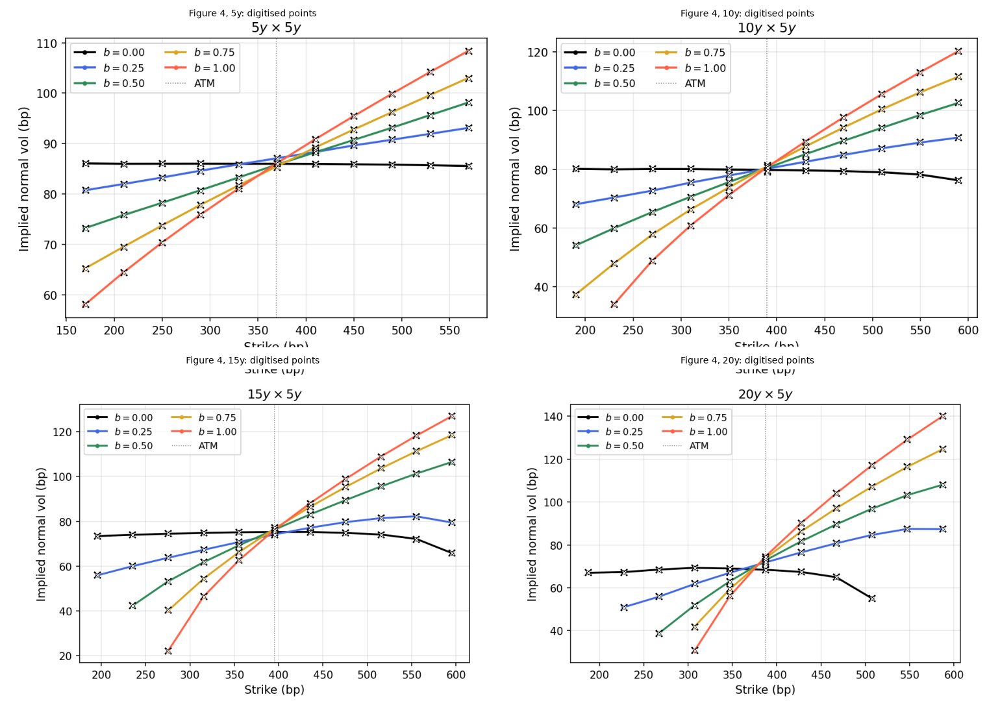

# Investigation of the open issues

Status of every issue in the replication of Piterbarg & Van Der Helm, *Term
Premia and Bond Convexity* (6 Nov 2026). Each section gives the status, the
evidence, and a table of the variants tried with their effect on what
already matched (Figures 2, 3, 5, 6, 9-13 and `sigma = 1.157%`).

Status vocabulary: **fixed** (with a test that would have caught it),
**built** (with tests), **explained** (the difference is understood and
quantified; nothing in the code was wrong), **paper inconsistency** (written
up in `questions_for_authors.md`), **unresolved** (with the evidence that
would settle it).

Conventions. All numbers are basis points unless stated. "s.e." is a
Monte-Carlo standard error from this code; differences under two s.e. are
not read as signal. Seeds are fixed in every script. Each experiment is a
script under `experiments/` that writes `experiments/results/<name>.json`;
the tables below are copied from their output. Figures digitised from the
paper are accurate to about 0.3bp (checked below).

| ID | Issue | Status |
|---|---|---|
| A9 | Definition of the yield option | **pinned down** except one bounded choice; question to authors |
| A1 | Figure 4 | **paper inconsistency** (contradicts the text, Figure 8 and the model's Gaussian limit; no single one of 96 pre-registered coding errors reproduces it); question to authors |
| A2 | Convexity at high skew | **partly fixed** (bootstrap grid); rest bounded by the cap definition, or the paper's sampling noise if its skew curves shared a seed; question to authors |
| A3 | Figure 9 at eta = 1.5 | **unresolved**, bounded; consistent with the paper's own sampling noise at the path count its other figures imply; question to authors |
| A4 | Figure 8 minimum and eta = 0 level | **fixed** (minimum: comparison axis); **paper inconsistency** (level) |
| A5 | Section 8.2 uplift | **explained** |
| A6 | Skew fit | **explained** to within Monte-Carlo noise; question to authors |
| A7 | Three-parameter fit | **explained**: eta not identified at Monte-Carlo precision; question to authors |
| A8 | Curve beyond the plotted range | **unresolved by construction**, bounded; question to authors |
| A10 | Two values of sigma for the skew fit | **paper inconsistency**, confirmed |
| B1 | Calibration with eta free | **fixed**: variance step smooth in eta, autodiff |
| B2 | Calibration speed | **fixed**: 2.6x on one core, 16x on 16 cores, same results |
| B3 | Gaussian decomposition example | **fixed**: baseline curve, compared with Figure 2 |
| B4 | Monte-Carlo noise | **fixed**: Gaussian-twin control variate (variance cut 14-28x); quasi-random Sobol with a Brownian bridge (23-290x with skew, 1-5x with stochastic vol) |
| B5 | Licence | **options listed**, none chosen (as instructed) |
| C1 | Multi-factor model | **built**, with tests |
| C2 | Ho-Lee closed forms | **built**, with tests |
| C3 | Forward-rate decomposition, Appendix F | **built**, with tests |
| C4 | Curve bootstrap from swap quotes | **built**, with tests |
| C5 | Equilibrium-rate and front-end refinements | **built** (one factor), with tests |
| C6 | GPU run | **built**: timings on CPU and GPU |
| C7 | Second smile market | **built**, data verified against the source |

## Summary

*What changed.* The yield option is pinned down from the paper's own
numbers (A9: the continuously compounded forward yield Y(T, T, T + 5);
strikes as offsets from the model mean by default, the forward reading
available and bounded). The volatility-scaling bootstrap now runs on a
converged monthly grid (A2). The Figure 8 comparison uses absolute strikes
(A4). Calibration with eta free uses autodiff through a variance step that
is smooth in eta (B1), runs 2.6x faster on one core and 16x on all cores
(B2), and yield options can be priced with a Gaussian-twin control variate
(B4). Built: the multi-factor model with the general bootstrap (C1), the
Ho-Lee closed forms (C2), the forward-rate decomposition and Appendix F
(C3), a curve bootstrap (C4), the equilibrium-rate and front-end drifts
(C5), a GPU run (C6) and a second, source-verified smile market (C7). Tests
went from 57 to 101; library defaults were not changed to chase a figure.

*What matches, and how closely.* Figure 2 to 0.24bp (digitisation error;
Monte Carlo against closed form 0.002bp). sigma = 1.157% for the 82bp
at-the-money vol (1.1572% at any seed with the control variate). With the
paper's skew parameters (1.1999%, b = 0.367), Figure 11 to -0.4..+0.7bp and
Figure 12 gamma(30y) 140.5 +- 0.2 against 140.3. Figure 9 at eta = 0.5 and
1.0 to 0.1 and 1.2bp. The Section 8.2 uplifts are the exact Jensen ratio,
14.5/16.3/17.5% against ~15/16/17.5%.

*What is still open* (each with a question in `questions_for_authors.md`):
Figure 4, which contradicts the paper's text, its Figure 8 and the Gaussian
limit (A1, Q6); convexity at b = 1 and 40y 1.7-2.6% low, inside the
sensitivity to the undefined cap (A2, Q7); Figure 9 at eta = 1.5, 204.2 +-
1.3 against 212.8bp (mean of four pricing seeds) (A3, Q2). Estimated from the paper's own scatter, A3,
A2 and the A4 level are all consistent with its sampling noise at about
10,000 paths, but no single path count fits every figure under every
seeding, so this is a sharper question, not an answer; the Figure 8 eta = 0 level, 71.4 against the
closed form's 70.9bp (A4, Q2); the skew fit's weights and path count (A6, Q2-Q3);
eta's identification in the three-parameter fit (A7, Q5); the curve beyond
the plotted range, a 7.5bp spread in Y_eh at 30y across extensions (A8, Q4); and the strike
reference of the yield option (A9, Q1). A licence is still to be chosen
(B5). Quasi-random numbers are now available (B4).

*Review of the equations.* A line-by-line check of the paper's Sections
3-9 and Appendices C-D against the code found no discrepancy (section
below); the one untested discretisation choice it raised, the P-drift
scheme, moves gamma away from the paper (A2).

---

## Review of the paper's equations against the code

Done after the A, B and C items, to look for anything that had been
missed. The paper's Sections 3-9 and Appendices C and D were read against
`model.py`, `pricing.py`, `volscale.py`, `gaussian.py`,
`decomposition.py`, `curve.py` and `multifactor.py`, re-deriving where the
code uses a different but equivalent form. Appendices B, E and F (C2, C3)
have their own tests and were not re-derived.

**No discrepancy was found.** Every equation used by the figures is
implemented as written, or in an equivalent form verified below:

| paper | code | check |
|---|---|---|
| (27) roll; (43) `f(t, T)` from the state | `model.simulate` (`rho`) | `rho = (f(t, t+delta) - r) / delta`, `f(t, t+delta) = f(0, t+delta) + e^(-kappa delta) (x + B(delta) y)` |
| (44), (86) benchmark yield | `Y_1 = Y(0, t, t+delta) + A x + B^2 y / (2 delta)` | `h^Y / h = A(delta)`; `Gamma / 2 = B^2 y / (2 delta)` |
| (45) drift, one factor | `mu_y = rho + sigma_r^2 B^2 / (2 delta)` | `int_0^delta e^(-kappa s) B(s) ds = B(delta)^2 / 2` |
| (47), (49) with Section 9.1's `lambda = A sigma / Ybar` | `local_vol`: `sigma ((1-b) + b Y_1 / Ybar)` | `H H^Y^-1 = 1/A`, so `sigma_r = sigma_Y / A` |
| (52) P-drift | exact discrete-martingale increment | the continuous drift of `Y_1` under (52) is identically zero: the `x` terms cancel by `A kappa delta = 1 - e^(-kappa delta)`, the `y` terms by `kappa B = 1 - e^(-kappa delta)`. So the two schemes agree as `dt -> 0`; the Euler form was tested separately (A2, *Drift scheme*) |
| (13), (54), (55) | `decompose` | `nu_P = B(T-t) mu^Y / A`, `sigma_P = sigma_r B(T-t)`, `r = f(0, t) + x` |
| (37) refined MPR | `lam = mu_y - d/dt E^P[Y_1]` | as in C5 |
| (42) bonds; forward-measure drift | `pricing.bond`, `_simulate_terminal_one` | Girsanov shift `-sigma_r^2 B(tau - t)` |
| (80)-(81) bootstrap, unweighted (Section 9.1) | `volscale.ybar_bootstrap` | the recursion is the right-end-point rectangle rule of (80), which the code telescopes |
| (85), (87), (90), (91), (93), (94) | `gaussian.py` | (90) re-verified: `I = -y B(tau - t)` solves (89) |
| (44), (45), (47), (52), (56), C.3.2, `d > 1` | `multifactor.py` | `H^Y = M H`; `sigma_r' = M^-1 S L` with `X = L L'`; `mu^Y` weights `W^(i)` from (45) |

**What the paper leaves open, and where each choice was tested.** The
remaining discrepancies come from choices the text does not make. Each one
has been run:

| open choice | where tested | effect on the open items |
|---|---|---|
| the yield option (underlying, measure, inversion forward, strike reference) | A9, A1, A4 | pinned down except the strike reference (bounded) |
| the cap of Remark 8 ("10x the initial volatility") | A2 | gamma(40y) at `b = 1` moves 26bp between 10x and 12x; the paper's values imply 10.4-11.4x, not one level; undetermined |
| the floor of the affine local vol (absorb, reflect, floor the rate) | A2, A1 | reflecting is within 0.1bp of absorbing; flooring the rate breaks a matched point by 3bp, ruled out |
| bootstrap expiry grid | A2 | up to 3.4bp at `b = 1`; monthly is converged |
| time step; volatility frozen over a step or predictor-corrector | A2 | daily steps (365/yr) move gamma(40y) by at most 0.5bp from monthly; both schemes agree at daily steps; the gaps stay (+2.8, +7.0, +3.3bp) |
| P-drift scheme (exact martingale or Euler) | A2 | Euler lowers gamma by 0.2-2.2bp, away from the paper |
| variance scheme for `z` | A3, B1 | reflection Euler changes Figure 9 at large eta; others agree |
| curve beyond the plotted range | A8 | 7.5bp in `Y_eh(30y)` |
| path count and seeding | A3 | consistent with A2, A3, A4 at about 10,000 paths, per-curve seeds |

The review found no implementation error, and it raised one untested
choice, the drift scheme, which has now been run. The open items (A1-A4,
A6-A8) therefore remain undisclosed choices or questions for the authors,
not misreadings of the paper's equations.

---

## Digitisation check (all A items)

`experiments/digitisation_overlay.py` maps every digitised value back to
pixels with the digitiser's own axis calibration and draws it on the
extracted figure image. Every point of the four panels of Figure 4, of
Figure 8 and of Figures 3, 6, 7 and 9 sits on the paper's own marker or
line. Digitisation error is ruled out as a cause of any of the A items.

Overlays of the other figures: [Figure 8](investigation/overlay_fig8.png),
[Figure 3](investigation/overlay_fig3.png), [Figure 6](investigation/overlay_fig6.png),
[Figure 7](investigation/overlay_fig7.png), [Figure 9](investigation/overlay_fig9.png).

---

## A9. What is the "yield option"?

**Status: pinned down, except whether strikes are offsets from the model
mean or from the curve forward; the two readings are bounded and both
are now available (`strike_reference=`).** The default stays "mean".

The paper never defines the option it calls a yield option (Figures 4, 8,
11; Section 9.4). Four choices are needed: the underlying, the measure
(equivalently the payment date), the forward around which implied vols are
inverted, and where strikes are measured from. Each is pinned by a different
published number.

**Underlying: the continuously compounded forward yield `Y(T, T, T+5)`.**
`experiments/a9_instrument_vols.py`, exact Gaussian prices (Jamshidian):

| 20y x 5y underlying | normal vol at sigma = 1% (baseline curve) | sigma for 82bp (market curve) |
|---|---|---|
| continuously compounded yield | 70.86 | **1.1572%** |
| simple rate L(T, T+5) (caplet) | 85.92 | 0.9267% |
| par swap, annual fixed | 73.80 | 1.1031% |
| par swap, semi-annual | 72.39 | 1.1279% |
| par swap, quarterly | 71.69 | 1.1405% |

The paper's caption to Figure 13 gives `sigma = 1.1572%`: five significant
figures, matched only by the yield. At `b = 0` its variance is the same in
every measure, so this does not yet fix the measure.

**Measure: the (T + delta)-forward measure** (payment at the end of the
window, as for the calibration caplets). `experiments/a9_measure_scan.py`
prices Figure 11 at the paper's own stated parameters (`sigma = 1.1999%`,
`b = 0.367`, no fitting) in the tau-forward measure for tau from T to T+5
and compares with the fitted vols the paper plots:

| tau | Figure 11: model minus paper's fitted vols at -200, -50, 0, +50, +200 |
|---|---|
| T | +11.6 +12.9 +13.2 +13.4 +14.1 |
| T + 1 | +8.8 +10.0 +10.3 +10.5 +11.0 |
| T + 2.5 | +5.1 +6.2 +6.4 +6.5 +6.9 |
| T + 4 | +1.8 +2.8 +2.9 +3.0 +3.2 |
| **T + 5** | **-0.1 +0.7 +0.8 +0.9 +1.0** (s.e. 0.6) |

The physical measure is excluded outright: there `x` has no mean reversion,
and the 20y at-the-money vol is 93bp at `sigma = 1%`, against 71.5bp in
Figure 8 (`experiments/a4_fig8_measures.py`).

**Inversion forward: the model's own mean of the yield in that measure.**
Inverting around the curve forward `Y(0, T, T+5)` instead gives 6.7-9.1bp
errors against Figure 8 at every eta, and prices below intrinsic at
low strikes (`experiments/a4_fig8_measures.py`, `a1_conventions.py`).

**Strikes: ambiguous between the model mean and the curve forward.** The
paper draws its at-the-money line at the curve forward in all three figures
(Figure 4: 370, 390, 395.5, 387.5 against forwards 369.1, 389.6, 395.3,
387.4; Figure 8: 387 against 387.4; Figure 11: 445 against 446.2). The two
figures that can discriminate disagree:

| | strikes from the model mean | strikes from the curve forward |
|---|---|---|
| Figure 11 at the paper's parameters, model minus paper's fit | -0.4 to +0.7 | +1.8 to +2.5 |
| Figure 8, mean abs error, eta = 0 / 0.5 / 1 / 1.5 | 0.39 / 0.58 / 1.32 / 1.23 | 0.39 / 0.52 / 1.50 / 0.63 |
| Figure 8, lowest plotted point (paper: at the money) | +50bp | at the money |

Figure 11 is the stronger evidence (a 2bp level difference, three s.e.;
Figure 8's preference rests on the location of a shallow minimum and on
differences of a few tenths of a basis point), and it is the figure that
feeds Figures 12 and 13, so the default remains strikes from the mean.
Effect of the choice on the skew fit (A6): `sigma` 1.190% against 1.165%,
`b` 0.354 against 0.372, `gamma(30y)` 135.5 against 129.5bp.

**Code changes.** `pricing.yield_option_prices` documents the reading and
gains `strike_reference="mean" | "forward"`; `yield_option_moneyness`
gives the strike to invert at; `calibration.calibrate_yield_smile`
evaluates its target and vega at that moneyness. Defaults unchanged, so no
existing result moves.

**Tests** (`tests/test_yield_option.py`): the Gaussian smile is flat at the
closed form for either reference; only the continuous yield gives 1.1572%;
the paper's stated skew parameters reproduce its Figure 11 fit with
mean-referenced strikes and miss with forward-referenced ones; 1.12% misses
by 3-5bp.

---

## A10. Two values of sigma for the skew fit

**Status: paper inconsistency, confirmed.** The text of Section 9.4 says
the skew fit gives `sigma = 1.12%`; the caption of Figure 13 says 1.1999%.
At `b = 0.367` (`experiments/a6_skew_fit.py`, `a10_text_sigma.py`):

| sigma | Figure 11: model minus paper's fitted vols | gamma(30y), paper 140.3 |
|---|---|---|
| 1.1999% | -0.4 to +0.7 (mean strikes) | 140.5 +- 0.2 |
| 1.12% | -4.5 to -5.3 (mean strikes); -3.0 to -3.9 (forward strikes) | 115.6 +- 0.2 |

1.12% does not reproduce Figure 11 under either strike reading, nor Figure
12. It is not the skew-fit sigma of any of the instrument readings in A9
either (the annual par swap would need 1.10% at `b = 0`). The test
`test_papers_skew_parameters_reproduce_its_figure_11_fit_with_mean_referenced_strikes`
checks both values.

---

## A4. Figure 8: position of the minimum and the eta = 0 level

**Status: minimum fixed (it was a strike-axis artefact in the comparison,
not in the model); the eta = 0 level is a paper inconsistency, most
plausibly Monte-Carlo noise in the paper's own run.**

The fix: `examples/stochvol_sweep.py` now plots both smiles against
absolute strike (this code's at mean + offset, the paper's at its
at-the-money line, 387bp, + offset), and
`test_figure_8_smile_minimum_on_absolute_strikes` checks that the eta = 1.5
smile bottoms out within 20bp of the paper's minimum (it is within 5bp; on
the old axis it would have read 27bp off).

*Minimum.* The old comparison plotted this code's strikes as offsets from
its own mean (364bp at 20y) against the paper's offsets from the curve
forward (387bp). On the paper's absolute strike axis the lowest point of
this code's smile is where the paper's is (A9 table above); the parabola
through the three lowest points puts the paper's minimum at 400-405bp and
this code's at 404-407bp. In the expiry-forward measure the minimum would
be at 365-370bp, so the comparison also confirms the measure.

*Level.* At `b = 0`, `eta = 0`, `sigma = 1%` the option is Gaussian and its
vol is exactly 70.86bp. Figure 8 plots 71.4 (text: 71.5) and its eta = 0
line is not flat: it tilts from 71.2 to 71.6bp across strikes. No pricing
convention makes a Gaussian smile tilt (A1 below), but a Monte-Carlo
estimate does, since all strikes share the same paths.
`experiments/a4_fig8_measures.py` measures the spread of the Gaussian
at-the-money vol estimate for plain (non-antithetic) paths:

| paths | spread of the ATM vol estimate | P(abs error >= 0.55bp) |
|---|---|---|
| 4,096 | 0.79bp | 0.41 |
| 16,384 | 0.40bp | 0.20 |
| 65,536 (this code, antithetic) | 0.33bp quoted s.e. | |

So the paper's level is what a run with 4k-16k paths produces a fifth to
two fifths of the time. Recalibrating Figure 9 to the paper's 71.5bp
instead of the exact level was tried (A3): it breaks the match at eta = 0.5
(136.1 against 133.6bp), so the paper's Figure 9 is not consistent with
71.5bp as an exact target either. Only the path count and seed of the
paper's run can settle this.

---

## A5. Section 8.2: uplift for eta = 0.6 over ten years

**Status: explained.** Section 8.2 computes the uplift from the Jensen gap
(65) of a driftless rate run on a stochastic clock; this code reports the
full model recalibrated to an at-the-money option. They are different
quantities and both are right. `experiments/a5_uplift.py` (variance weights
`exp(-2 kappa (T - t))`, i.e. the weight with which variance at t reaches
the rate at expiry, `kappa_z = 0.1`, `T = 10`):

| kappa | relative variance | 1 + rel. var / 4 | **exact E(V) / E(sqrt V)^2** | paper | full model, yield option | full model, caplet |
|---|---|---|---|---|---|---|
| 0 | 0.605 | 15.1% | **14.52 +- 0.03%** | ~15% | 13.49% | 14.16% |
| 0.03 | 0.678 | 17.0% | **16.27 +- 0.03%** | ~16% | 15.41% | 15.79% |
| 0.05 | 0.728 | 18.2% | **17.51 +- 0.04%** | 17.5% | 16.73% | 16.99% |

The paper's numbers are the exact Jensen ratio (not the second-order
approximation, which overstates by 0.6-0.7 points); its ς² ≈ 0.6 is our
0.605. The full-model columns above are single runs; repeated over four
seeds at 131,072 paths the kappa = 0 yield-option uplift is 13.85 +- 0.07%
(single-run spread 0.15), so the 13.49% of a single 65,536-path run was a
low draw.

Where the remaining 0.6-0.7 points go (`experiments/a5_drift_attribution.py`,
same variance paths and rate noise throughout):

| kappa | exact Jensen | model rate made driftless | + forward-measure drift (y term, -sigma_r^2 B) | same, sigma solved exactly | full model |
|---|---|---|---|---|---|
| 0 | 14.52% | 14.44% | 14.15% | 14.09% | 13.85 +- 0.07% |
| 0.03 | 16.27% | 16.17% | 15.99% | 15.94% | |
| 0.05 | 17.51% | 17.41% | 17.25% | 17.21% | |

The driftless model rate reproduces the Jensen ratio (to 0.1 points of
time discretisation). The drift that the benchmark yield has in the forward
measure is itself driven by the realised variance and takes another 0.3-0.4
points; the rest (0.2 points at kappa = 0) is within 1.6 single-run
standard deviations. Nothing is wrong on either side: Section 8.2 states the
idealised effect, the model includes the drift. The README previously set
one against the other.

---

## A8. The curve beyond the plotted range

**Status: unresolved by construction, bounded.** Y_eh and theta at the last
plotted maturity depend on forwards up to five years beyond it, which no
figure shows. `experiments/a8_extrapolation.py` tries four extensions of the
digitised zero curve (all reproduce the digitised yields inside the plotted
range to 0.4-0.6bp):

| market curve, T = 30y | quadratic (library) | linear | flat zero | flat forward | paper |
|---|---|---|---|---|---|
| Y_eh | 377.9 | 373.6 | 370.4 | 373.8 | 376.4 |
| theta | 173.1 | 177.4 | 180.6 | 177.2 | 174.7 |
| gamma | 107.8 | 107.8 | 107.8 | 107.8 | 108.0 |

| baseline curve, T = 40y | quadratic | linear | flat zero | flat forward | paper |
|---|---|---|---|---|---|
| Y_eh | 304.9 | 303.2 | 300.0 | 303.2 | 304.8 |

Convexity does not depend on the extension at `b = 0`. Y_eh and theta move
together by up to 7bp in opposite directions (their sum is fixed by the
curve). The paper's 30y values lie inside the band, between the quadratic
and the linear extension, and its 40y Y_eh on the baseline curve matches
the quadratic one to 0.1bp. The 1.5bp residual at 30y is therefore within
what the unpublished part of the curve leaves open; only the authors' curve
beyond 30 (and 40) years can close it. Inside the plotted range, at 20y and
25y, all four extensions agree with each other and with the paper to 0.3bp.

---

## A3. Figure 9 at eta = 1.5

**Status: unresolved, bounded.** This code gives 202.7 +- 1.3bp at 40y where
the paper plots 212.8bp; eta = 0.5 and 1.0 match (133.7 vs 133.6, 165.5 vs
166.7).

*The README's hypothesis is refuted.* It said the paper's convexity ratios
equal the squared ratios of its at-the-money vols, as if sigma were
rescaled linearly. They do not: at eta = 0.5 the paper's ratio is 1.121
against a squared vol ratio of 1.166 (1.169 with 71.5bp). This code's exact
recalibration gives 1.124 there, matching the paper.

*Variants, one at a time* (`experiments/a3_stochvol_variants.py`; sigma
recalibrated at each eta to the eta = 0 ATM vol; gamma(40y), paper 133.6 /
166.7 / 212.8):

| variant | eta = 0.5 | eta = 1.0 | eta = 1.5 |
|---|---|---|---|
| library (QE, cap 10x, 24 / 12 steps a year) | 133.7 | 165.5 | 202.7 |
| pricing seed 1 / 2 / 3 | 133.5 / 133.3 / 134.3 | 165.0 / 164.9 / 168.0 | 203.8 / 202.3 / 208.0 |
| recalibrate to 71.5bp (paper's text) | **136.1** | 168.4 | 206.2 |
| no cap; cap in pricing only; in decomposition only; 20x | 133.7 | 165.5 | 202.7 |
| cap 5x | 133.7 | 165.5 | 201.0 |
| 52 steps a year in both | 133.8 | 165.0 | 203.8 |
| full-truncation Euler for z | 133.7 | 166.0 | 205.0 |
| reflection Euler for z | 133.7 | **153.2** | **160.1** |

- The cap never binds at `b = 0` for eta <= 1.5 (`sqrt(z) > 10` is too rare
  to move any digit), so neither its level nor where it is applied matters.
- Reflection inflates E[z], so the at-the-money vol *rises* with eta (85.8bp
  at eta = 1.5): ruled out by Figure 8.
- Recalibrating to 71.5bp breaks eta = 0.5.
- No variant reaches 212.8 without breaking eta = 0.5 or 1.0.

*Variance scheme against exact sampling.* `experiments/a3_exact_cir.py`
drives the same rate dynamics with exact CIR draws (noncentral chi-square)
and with the two schemes, four independent seeds of 131,072 paths each,
20y x 5y ATM vol at `sigma = 1%`, `b = 0`:

| eta | exact CIR | QE (library) | lognormal (B1) | paper (Figure 8) |
|---|---|---|---|---|
| 1.0 | 59.71 +- 0.07 | 59.60 +- 0.15 | 59.65 +- 0.16 | 60.87 |
| 1.5 | 53.32 +- 0.06 | 53.37 +- 0.18 | 53.46 +- 0.15 | 53.58 |

QE is unbiased at the 0.1bp level against exact sampling, so the scheme is
not the cause. The paper's Figure 8 sits +1.2bp and +0.3bp above these
precise values (and -0.7bp below this code's single run at eta = 0.5):
non-monotone in eta, as independent sampling errors would be.

*Noise.* The quoted s.e. (1.3bp) covers the decomposition only. The
recalibrated sigma inherits the pricing noise: over four pricing seeds
gamma(40y) is 202.7, 203.8, 202.3, 208.0 (mean 204.2 +- 1.3, spread 2.6bp).
The paper is 8.6bp above that mean: about three single-run standard
deviations at 65,536 paths, so not explained by this code's noise.
If the paper's runs used 4k-16k paths, as its eta = 0 level suggests (A4),
its own single-run spread would be 5-10bp and 212.8 would be within two of
them. That is the only explanation left standing and it cannot be checked
without the paper's path count and seeds. Section B4 shows that a control
variate does not help here (the twin does not see z); a conditional
(Rao-Blackwell) estimator would.

*The paper's path count, estimated from its own noise*
(`experiments/a3_paper_path_count.py`; plan, data, held-out points and
decision rules committed in `2a07a1d` before the first run). The paper does
not state its path count. If its Monte-Carlo figures differ from precise
values only by its own sampling error, one N should explain the scatter of
every undisputed point, and the disputed ones should be ordinary draws.
Data: 37 points of Figures 3, 6, 7, 8, 9, 11 and 12 (gamma at 20/40y, smiles
at three strikes, the Figure 11 fit), against precise values and single-run
covariances from 512 replicate runs of this code (8,192 plain or 16,384
antithetic paths each), plus 0.3bp digitisation. N is fitted by maximum
likelihood on the undisputed points and the disputed ones are tested
conditionally: A3 (Figure 9, eta = 1.5), A4 (Figure 8, eta = 0) and A2
(Figures 3 and 6, b >= 0.75). Three ways the paper may have shared seeds:
one for everything (A), one per figure (C), one per curve (B). Four points
are hidden in the figures where lines cross and are dropped (a bug fix after
the first run: they were NaN).

| seeds | estimator | N (95%) | fit p | per-figure N consistent | A3 p | A4 p | A2 p | pre-registered verdict |
|---|---|---|---|---|---|---|---|---|
| one | plain | 1.8k (0.6-6.0k) | 0.04 | no | 0.12 | 0.34 | 1.00 | refuted |
| one | antithetic | 1.1k (0.4-3.5k) | 0.04 | no | 0.29 | 0.29 | 1.00 | refuted |
| per figure | plain | 5.6k (2.5-12.6k) | 0.68 | no | 0.29 | 0.03 | 1.00 | refuted |
| per figure | antithetic | 4.7k (2.1-10.0k) | 0.66 | no | 0.31 | 0.001 | 0.98 | refuted |
| per curve | plain | 13.6k (6.7-25.1k) | 0.85 | no | 0.53 | 0.70 | 0.58 | refuted |
| per curve | antithetic | 10.5k (5.0-20.0k) | 0.70 | yes (13-21k) | 0.62 | 0.87 | 0.64 | **supported** |

(N counts paths; p values for the held-out groups at the fitted N. Per-curve
seeds have the highest likelihood, by about 5 log-units over per-figure.)

What this shows:

- **A single path count is not established.** The rules fixed in advance
  give "supported" in one variant of six. Every other variant fails on the
  same conflict: Figure 8 (the eta = 1.0 smile sits 1.5-2.0bp above the
  precise value at all three strikes) wants a few thousand paths, while
  Figure 9's eta = 0.5 and 1.0 curves sit within 0.35bp of the precise
  values, which a few thousand paths would rarely produce. Different path
  counts per figure would fit, but that was not the hypothesis tested and
  would be fitted after the fact.
- **A3 is consistent with sampling noise wherever the rest of the data put
  N.** In all six variants 212.8bp is an ordinary draw at the fitted N
  (p 0.12-0.62; conditional z +1.0 to +2.1 at 40y). It is not if the paper
  used 25,000 paths or more (p 0.001 at the top of the one-seed interval).
- **A4 depends on the seeding.** The eta = 0 level is ordinary under per-
  curve seeds (p 0.70, 0.87) but not under per-figure seeds with antithetic
  paths (p 0.001), where Figure 8's other smiles fix the shared error.
- **A2 is consistent with noise if a figure's skew curves shared a seed.**
  At 40y the paper is above the precise value for every skew in both
  figures, growing with b (Figure 3: +0.8, +3.2, +5.4, +6.5; Figure 6: +0.4,
  +1.1, +2.4, +3.2). Independent seeds per curve would give that sign
  pattern about one time in 256; a seed shared across b gives it naturally,
  and then b >= 0.75 is predicted from b <= 0.5 (p 0.98-1.00). A bias that
  grows with b (the cap, Q7) predicts the same pattern; one run per figure
  cannot tell them apart.

The status stays **unresolved**, now with the evidence that would settle
it: the paper's path count, whether its paths were antithetic, and whether
curves in one figure shared a seed. With 10,000 or so paths and per-curve
seeds, A3, A4 and A2 would all be sampling noise.

---

## A6. The skew fit on the market smile

**Status: explained to within Monte-Carlo noise; the fitting weights and
path count are questions for the authors.**

*The paper's parameters are consistent with this code.* At `sigma =
1.1999%`, `b = 0.367` this code reproduces the paper's plotted fitted vols
to -0.4..+0.7bp (s.e. 0.6) and Figure 12's gamma(30y) to 140.5 +- 0.2
against 140.3 (A9, A10). The engine is not the issue; the fit is.

*Weights.* The paper says the fit matches the at-the-money quote exactly.
Equal weights miss it by 1.9bp, so the at-the-money quote is pinned (weight
30). Fits (`experiments/a6_skew_fit.py`, 65,536 paths):

| strikes from | weights | sigma | b | fitted vols | gamma(30y) |
|---|---|---|---|---|---|
| mean | equal | 1.2181% | 0.346 | 74.7 81.7 83.9 86.1 92.5 | 144.2 |
| mean | ATM pinned | 1.1897% | 0.354 | 72.9 79.8 82.0 84.2 90.5 | 135.5 |
| forward | equal | 1.1918% | 0.365 | 74.7 81.7 83.9 86.1 92.5 | 137.4 |
| forward | ATM pinned | 1.1652% | 0.372 | 72.9 79.8 82.0 84.2 90.5 | 129.5 |
| paper | | 1.1999% | 0.367 | 73.4 79.8 82.0 84.2 90.7 | 140.3 |

With the at-the-money quote pinned, the fitted smile matches the paper's
fitted smile to 0.45bp under either strike reading, yet sigma, b and gamma
differ: the five quotes fix a valley in (sigma, b) along which gamma(30y)
moves by about 10bp per basis point of smile level.

*Noise.* The same fit over six pricing seeds (`experiments/a6_fit_noise.py`):

| paths | sigma | b | gamma(30y) |
|---|---|---|---|
| 32,768 | 1.1888 +- 0.0095% | 0.3530 +- 0.0060 | 135.1 +- 2.7 |
| 65,536 | 1.1890 +- 0.0055% | 0.3526 +- 0.0027 | 135.1 +- 1.7 |
| paper | 1.1999% | 0.367 | 140.3 |

(+- is the spread of a single fit.) The paper's point is 1-2 single-fit
standard deviations away at 32k paths in sigma and gamma, and 2-5 in b.
The difference corresponds to a 0.5bp shift of the fitted smile level, the
size of one pricing s.e. of either code. With the control variate of B4 the
fit noise falls (see B4), which leaves the paper's own path count and
weights as the open question.

---

## A7. The three-parameter fit

**Status: explained. eta is not identified by the five quotes at
Monte-Carlo precision, which is the paper's own conclusion in different
words.** Both the paper's point and this code's lie on the same valley.

`experiments/a7_three_param.py` profiles the fit: eta fixed on a grid,
(sigma, b) fitted by autodiff with the at-the-money quote pinned, 32,768
paths, strikes from the mean.

| eta | sigma | b | errors at -200, -50, 0, +50, +200 | rms | gamma(30y) |
|---|---|---|---|---|---|
| 0 | 1.194% | 0.353 | -4.26 -0.04 0.01 -0.60 -4.77 | 2.87 | 136.9 +- 0.3 |
| 0.4 | 1.271% | 0.366 | -3.37 0.07 0.01 -0.58 -4.07 | 2.38 | 171.7 +- 1.3 |
| 0.6 | 1.365% | 0.382 | -2.70 0.11 0.01 -0.53 -3.54 | 2.00 | 223.9 +- 2.7 |
| **0.779** | 1.468% | 0.395 | -2.26 0.15 0.01 -0.54 -3.21 | 1.77 | 290.5 +- 4.0 |
| 1.0 | 1.597% | 0.399 | -1.98 0.23 0.01 -0.53 -2.82 | 1.56 | 377.0 +- 6.3 |
| 1.2 | 1.698% | 0.391 | -1.77 0.26 0.00 -0.53 -2.68 | 1.46 | 434.3 +- 7.8 |
| **1.39** | 1.787% | 0.372 | -1.61 0.33 0.00 -0.52 -2.46 | 1.34 | 457.5 +- 8.6 |
| 1.6 | 1.859% | 0.349 | -1.56 0.39 0.00 -0.61 -2.35 | 1.30 | 464.1 +- 9.4 |

| point | errors | rms | gamma(30y) |
|---|---|---|---|
| paper (1.492%, 0.417, 0.779) | -2.61 0.56 0.60 0.22 -2.01 (s.e. up to 1.27) | 1.52 | 315.6 +- 4.4 |
| this code's earlier fit (1.80%, 0.36, 1.39) | -0.84 1.15 0.84 0.31 -1.65 (s.e. up to 1.44) | 1.05 | 463.6 +- 8.6 |
| full fit started at sigma 2.6%, eta 2 | -0.99 1.16 0.78 0.18 -1.29 at (1.95%, 0.32, 2.27) | | |

- The rms error falls monotonically along the valley; it has no interior
  minimum. Beyond eta ~ 0.8 the whole improvement (1.77 to 1.30bp) is
  smaller than the pricing s.e. of a single quote (about 1.3bp with
  stochastic volatility), so where a fit "converges" is set by the noise
  of its random numbers. The paper's point is within two s.e. of the
  quotes, as is this code's.
- The "spurious basin" is not separate: it is the same valley continued to
  larger eta, where the cap starts to do work.
- What the valley does to convexity is the point the paper makes: gamma(30y)
  runs from 137 to 464bp across fits that are equally good to Monte-Carlo
  precision; at the paper's own point it is 316bp ("not economically
  plausible").

The B1 lognormal variance scheme makes this fit differentiable in eta (and
faster), but it cannot make eta identified. What would: more expiries or
the curvature of the smile further out, or far more paths (the s.e. has to
fall below the 0.5bp rms differences along the valley).

---

## A1. Figure 4 (yield-option smiles by skew)

**Status: paper inconsistency.** No reading of the option, of the
volatility scaling or of the local volatility reproduces Figure 4 at 10-20
years; the figure contradicts the paper's own text and its own Figure 8;
and its `b = 0` smiles are not those of any Gaussian model. Digitisation is
ruled out (overlay above).

*The figure against the text.* Change of the at-the-money vol from `b = 0`
to `b = 1`:

| expiry | paper's text | paper's Figure 4 | this code, strikes from the mean | from the forward |
|---|---|---|---|---|
| 5y | "around 4bp below" | 0.0 | -4.5 | -3.3 |
| 10y | | +1.5 | | |
| 15y | | +1.2 | | |
| 20y | "6 to 8bp" below | **+5.9** | -9.0 | -5.1 |

This code agrees with the text (to within the strike-reference ambiguity of
A9); the figure has the opposite sign.

*The figure against Figure 8.* The 20y `b = 0` smile of Figure 4 is the same
option as the eta = 0 smile of Figure 8 (`sigma = 1%`, `b = 0`, `eta = 0`).
Figure 8 has it flat at 71.4bp; Figure 4 has it at 68.4bp at the money,
drooping to 55.1bp at +120bp, with no points at all at +160 and +200bp.

*The b = 0 smiles are not Gaussian under any convention.* At `b = 0` the
yield is Gaussian with the same variance in every measure, so any pricing
convention gives `price = c * Bachelier(m, K, s)` inverted with some forward
F. `experiments/a1_gaussian_fingerprint.py` fits `c` and `m - F` freely to
the paper's `b = 0` points, for calls, puts and out-of-the-money options:

| expiry | Gaussian vol | best fit: rms, convention, c, m - F |
|---|---|---|
| 5y | 86.31 | 2.1bp: any (the paper is flat at 86.0; fine) |
| 10y | 80.53 | 0.4bp: puts, c = 0.98, -2.3bp |
| 15y | 75.40 | 1.6bp: puts, c = 0.92, -15.7bp |
| 20y | 70.86 | 3.2bp: puts, c = 0.80, -40.7bp |

Even with two free parameters the 15-20y shapes (flat, then a cliff, then
missing points) are not reached, and the parameters needed are not those of
any measure or numeraire (a 20% price scaling). A Gaussian smile cannot
lose points at +160bp at 20y, half a standard deviation from the money,
unless prices fall below intrinsic, i.e. unless the inversion forward and
the option's mean disagree (or the price is wrong).

*Every reading of the option* (`experiments/a1_conventions.py`; b = 0 to 1,
sigma = 1%, strikes on the paper's grid, forward + 40k bp). Mean absolute
error against Figure 4, and points missing (model / paper):

| measure / inversion forward | 5y | 10y | 15y | 20y |
|---|---|---|---|---|
| Q^(T+delta) / model mean (library) | 1.1 [0/3] | 7.1 [0/2] | 11.0 [0/6] | 15.6 [0/11] |
| Q^(T+delta) / curve forward | 7.6 [4/3] | 9.6 [2/2] | 12.7 [2/6] | 18.3 [2/11] |
| Q^T (= spot Q, discounted) / model mean | 1.9 | 6.5 | 9.7 | 12.4 |
| Q^T / curve forward | 9.8 | 13.3 | 15.6 | 16.1 |
| P / model mean | 7.1 | 14.3 | 19.4 | 21.6 |
| P / curve forward | 12.9 [12/3] | 11.5 [6/2] | 7.9 [2/6] | 11.9 [0/11] |
| P, discounted pathwise / curve forward | 18.1 | 26.9 | 33.4 | 42.7 |

(The "missing" counts for the paper include points hidden where lines
cross; at 20y the genuinely absent markers are `b = 0` at +160, +200, `b = 0.5`
at -200, -160 and `b = 1` at -200 to -120.)

*Every scaling and local-volatility variant* (`experiments/a1_scaling_variants.py`,
library measure). The slope of the 20y `b = 1` smile between -80 and +200bp
is 110bp in the paper:

| variant | error 5 / 10 / 15 / 20y | 20y b = 1 slope | ATM change b = 1 vs 0, 5y / 20y |
|---|---|---|---|
| library (annual unweighted bootstrap), strikes from mean | 1.2 / 7.2 / 11.2 / 16.3 | 25.4 | -4.5 / -9.0 |
| strikes from forward | 0.8 / 7.0 / 11.0 / 15.6 | 24.5 | -3.3 / -5.1 |
| zeroth-order scaling (79) | 1.8 / 7.9 / 12.6 / 18.9 | 22.7 | -5.5 / -15.5 |
| bootstrap, monthly grid | 1.0 / 7.1 / 11.2 / 16.3 | 25.4 | -3.9 / -9.1 |
| bootstrap, weighted (80) | 1.2 / 7.2 / 11.3 / 16.6 | 25.1 | -4.5 / -9.9 |
| floor on the rate, not the vol | 1.2 / 7.2 / 11.2 / 16.3 | 25.4 | -4.5 / -9.0 |
| relative vol flat (literal (49)) | 3.8 / 7.9 / 11.7 / 16.7 | 24.9 | -5.4 / -9.9 |

Nothing moves the slope off 25bp: the model's smile at `b = 1` is what a
lognormal-like local volatility on a 20% relative vol gives, and the
paper's is four times steeper. The 5y panel is matched (1.1bp) by the
library reading.

*What Figure 4 looks like.* The pattern (a positive skew steepening with
expiry, missing points where the vol falls, a drooping `b = 0` line) is
what one gets when option prices are inverted around a forward that does
not match the distribution priced, a mismatch that grows with expiry. We
could not find a mismatch that reproduces it quantitatively and do not
claim one. Only the authors' Figure 4 code can settle it.

*Search for a coding error (pre-registered).* `experiments/a1_bug_search.py`
fixed, before it was run (commit 8810f5c), 96 zero-parameter error
hypotheses, four signatures of the 20y panel and the decision rules. The
hypotheses are:

- 90 pricing recipes: distribution in `Q^(T+delta)`, `Q^T`, spot `Q` with
  the discount forgotten, `P`, or `P` discounted pathwise; inversion
  forward at the sample mean, the curve forward, or today's benchmark
  `Y(0, 0, 5)`; calls, puts, out-of-the-money, or in-the-money (the
  out-of-the-money test with its sign flipped); strikes from the curve
  forward or from the mean.
- 4 with a numeraire left in the price (`P(0, T+5)/P(0, T)` or `P(0, T)`).
- 2 local-volatility errors (local variance linear in `Y`; local vol
  squared).

The signatures (paper's values in brackets):

- S1: the `b = 0` smile droops: at +120 it is at least 8bp below its ATM
  value, and at +160 and +200 it is absent or at least 20bp below
  [-13.3; absent].
- S2: ATM rises with skew, `b = 1` minus `b = 0` above +2bp [+5.9].
- S3: the `b = 1` slope from -80 to +200 is at least 80bp [109].
- S4: `b = 1` is absent at -200, -160 and -120.

A hypothesis "reproduces" Figure 4 only if it passes all four signatures
and is within 3bp of the paper in every panel. The 5, 10 and 15y panels
were held out.

Settings: 2^17 antithetic paths; Monte-Carlo s.e. of the 20y vols
0.3-1.1bp.

**Result: all 96 are refuted, and none passes more than two signatures.**
Each signature is reached by some hypotheses:

| signature | hypotheses that pass it |
|---|---|
| S1 | 5 |
| S2 | 35 |
| S3 | 5 |
| S4 | 10 |

But no hypothesis passes S1 together with S3 or S4. Puts inverted around a
forward below the distribution's mean give the drooping `b = 0` line.
Calls inverted around a forward above it give the steep skew and the
missing low strikes. A single convention cannot do both. The closest rows,
with errors in bp:

| hypothesis | signatures | error 5 / 10 / 15 / 20y |
|---|---|---|
| `Q^T`, curve forward, out of the money, strikes from the curve | S2 | 4.3 / 5.9 / 8.5 / 9.6 |
| `Q^T`, today's benchmark, out of the money | S2, S3 | 19.4 / 20.2 / 19.5 / 17.8 |
| spot `Q` without discount, curve forward, puts | S1, S2 | 11.3 / 20.6 / 28.5 / 35.3 |
| library (`Q^(T+delta)`, mean) | none | 1.4 / 7.1 / 10.9 / 15.5 |

The library row reproduces the earlier conventions run (1.1 / 7.1 / 11.0 /
15.6) on a different seed and path count.

If Figure 4 comes from a coding error, it is not a single one of these.
It would have to be a combination of errors, or an error in the
simulation itself; the latter would not touch the 5y panel, which the
library matches. This narrows Q6 but does not answer it.

---

## B1. Calibration with eta free: finite differences

**Status: fixed.** `Model(variance_scheme="lognormal")` is a variance step
that is smooth in eta, so calibrations with eta free use autodiff; QE stays
the default.

*Why finite differences were not sound.* The quadratic-exponential scheme
switches branch at psi = 1.5, so at fixed random numbers a path's variance
jumps as eta moves. Its autodiff derivative ignores the jumps, and finite
differences straddle them: on the paper's three-parameter point
(`experiments/b1_variance_schemes.py`, d price / d eta for three strikes) the
QE finite-difference derivative changes with the step (-0.00148 at h = 1e-3,
-0.00197 at h = 1e-2, -0.00151 at 1e-4 for the low strike), and disagrees
with QE autodiff (-0.00189).

*The scheme.* The moment-matched lognormal step of Andersen and
Brotherton-Ratcliffe: `z' = m exp(-s^2/2 + s xi)`, `s^2 = log(1 + psi)`, with
the same conditional mean `m` and variance as QE (and as exact CIR), so
`E[z] = 1` holds without time-step bias. Alternatives considered: exact
sampling (Poisson-gamma mixture; not differentiable in eta through the
Poisson count), likelihood-ratio estimators (unbiased but with variance
growing with the number of steps, 480 here), smoothing QE's branch switch
(biased at the switch). The lognormal step is the simplest that is both
smooth and moment-exact.

*Validation.*

| | exact CIR | QE | lognormal |
|---|---|---|---|
| E[z(20y)], eta = 1.5 | 0.988 +- 0.018 | 0.992 +- 0.018 | 0.986 +- 0.018 |
| Var z(20y) (exact 11.04) | 10.59 | 10.59 | 10.46 |
| E[int z] / sd | 19.78 / 40.8 | 19.69 / 41.0 | 19.68 / 41.0 |
| P(z(20y) < 1e-3) | 0.454 | 0.512 | 0.160 |
| 20y ATM vol, eta = 1.0 (4 seeds x 131k) | 59.71 +- 0.07 | 59.60 +- 0.15 | 59.65 +- 0.16 |
| 20y ATM vol, eta = 1.5 | 53.32 +- 0.06 | 53.37 +- 0.18 | 53.46 +- 0.15 |
| smile at the paper's 3-parameter point, -200..+200 | 74.7 .. 93.1 | 75.2 .. 93.8 | 75.1 .. 93.9 (within 0.03 of QE) |

The lognormal step puts less mass near zero (as expected of a lognormal),
but option prices and convexity depend on the integrated variance, whose
moments it reproduces; prices agree with exact sampling within the s.e.

*Derivative.* Lognormal autodiff against central differences: -0.0019525 /
-0.0044982 / -0.0045482 against -0.0019524 / -0.0044964 / -0.0045481 at
h = 1e-4: four digits. `tests/test_variance_schemes.py` checks the
conditional moments, autodiff against finite differences, agreement with QE,
and recovery of known (sigma, b, eta) by a fit that uses autodiff.

*Effect* (`experiments/b1_fit_timing.py`, the paper's smile, 32,768 paths,
same start): QE with finite differences 83s, ending at (1.752%, 0.379,
1.274); lognormal with autodiff 40s, ending at (1.710%, 0.380, 1.178).
Both stop on the same valley (A7), with errors within 0.1bp of each other.

---

## B2. Calibration speed

**Status: fixed.** The (sigma, b) skew fit of Section 9.4 (32,768 paths,
24 steps a year) went from 56.7s to 21.4s on one core with identical results
(sigma 1.1940%, b 0.3529 to every printed digit), and to 3.6s with paths
split over 16 cores.

*Profile* (`experiments/b2_profile.py`, before the changes):

| | calls | time |
|---|---|---|
| residual (jitted) | 17 | 2.8s first (compile), then 0.99s each |
| Jacobian (separately jitted forward mode) | 14 | 3.7s first, then 1.12s each |
| everything else | | **19.8s** |

The "everything else" was almost all one call: the final evaluation after
the fit ran outside `jit`, and the first eager evaluation of the volatility
bootstrap in a process costs 17.3s of one-off compilation of small
operations (0.12s the second time).

*Changes*, each measured:

| change | fit time | result |
|---|---|---|
| before | 56.7s | 1.1940%, 0.3529 |
| final evaluation jitted | 43.0s | same |
| residual and Jacobian from one cached forward-mode pass (least_squares asks for both at each accepted point; the tangent pass computes the primal anyway) | 21.4s (with the jitted final evaluation) | same |
| paths split across 16 host devices (`pricing.set_path_devices`) | **3.6s** | 1.1881%, 0.3593: other random numbers, within the fit's seed spread (0.0095%, 0.0060) |

A first fused version computed the residual twice inside the pass, and XLA
did not merge the two scans (2.1s per call); computing it once fixed that.
The bootstrap itself was vectorised as part of A2 (it telescopes; identical
to 1e-12), which made monthly grids affordable.

*Path splitting.* JAX runs these scans on one CPU core. Starting Python with
`XLA_FLAGS=--xla_force_host_platform_device_count=<n>` and calling
`pricing.set_path_devices(n)` splits the paths of every pricing simulation
across n devices with `shard_map`, one key per device, reassembled so that
path i and path i + N/2 stay antithetic partners. Simulation time for
65,536 paths x 480 steps (`experiments/b2_sharding_probe.py`):

| devices | 1 | 4 | 8 | 16 |
|---|---|---|---|---|
| seconds | 2.10 | 0.52 | 0.35 | 0.20 |

It is opt-in: results then depend on the device count (within Monte-Carlo
error), so the default is unchanged. `tests/test_path_sharding.py` runs four
devices in a subprocess and checks the antithetic alignment and agreement
within Monte-Carlo error. Timings were taken while another user's GPU
inference server shared the machine's memory bandwidth; ratios are more
reliable than absolute times.

---

## B4. Monte-Carlo noise: variance reduction

**Status: fixed.** `yield_option_prices(..., control_variate=True)` (and
`calibrate_yield_smile(..., control_variate=True)`) subtracts the same option
on a Gaussian twin driven by the same random numbers (b = 0, eta = 0, same
sigma), priced exactly for the discrete scheme (its mean and variance are a
linear Gaussian recursion carried in the same scan), with the regression
coefficient estimated per strike. Quasi-random numbers with a Brownian
bridge were the other option; the control variate was chosen because the
paper's own calibration instrument is close to Gaussian, so the twin
removes most of the noise, and it needs no new dependency (kooderive's
Sobol tables are GPL).

`experiments/b4_control_variate.py`:

*sigma for an 82bp at-the-money vol* (8 seeds; exact for the continuous
model 1.15721%):

| paths | plain | control variate |
|---|---|---|
| 32,768 | 1.15595 +- 0.00981% (1.1400-1.1743) | 1.15715 +- 0.00000% |
| 65,536 | 1.15646 +- 0.00531% (1.1501-1.1633) | 1.15715 +- 0.00000% |

In the Gaussian case the estimator has zero variance: every seed gives the
discrete scheme's exact value (1.15715%, 0.005% below the continuous one at
24 steps a year). The README's 1.161% / 1.157% difference was this noise.

*Standard-error ratio* (plain / control variate), 20y option at -200, 0,
+200bp from the mean:

| | eta = 0 | eta = 0.5 |
|---|---|---|
| b = 0 | ~1e5 (exact) | 1.2-1.5 |
| b = 0.367 (the market fit) | 3.7-5.3 (variance / 14-28) | 1.4-1.5 |
| b = 1 | 1.8-2.3 | 1.4-1.5 |

*Skew fit* (6 seeds, 32,768 paths, annual bootstrap grid as before A2): sigma 1.1888 +- 0.0036% (plain:
+- 0.0095%), gamma(30y) 135.0 +- 1.5bp (plain: +- 2.7), b 0.3521 +- 0.0079
(plain: +- 0.0060). The twin has no skew, so it removes the level noise but
not the slope noise that b responds to: b is no better determined. With
stochastic volatility the twin does not see z and helps little; a
conditional (Rao-Blackwell) estimator given the variance path would, and is
the next step if eta matters.

`tests/test_control_variate.py` checks that the estimator is exact in the
Gaussian case for both strike references, unbiased against the plain
estimator with skew and stochastic volatility, and that it reduces the
standard error at the market skew.

*Quasi-random numbers.* `qmc.sobol_normals` generates randomised
quasi-random normals: Owen-scrambled Sobol points, laid onto each Brownian
path by a Brownian bridge. The bridge gives the first, best-spread
coordinates to the path's end point and midpoints, and the fine detail to
later ones. The rate and variance drivers are interleaved. This is the
textbook construction (Glasserman 2004, Section 5.5), the one generally
recommended for interest-rate models; we did not have Andersen and
Piterbarg (2010) to check its exact recipe against. `simulate` and
`simulate_terminal` take the draws through `normals=` in place of the
pseudo-random ones. Each independent scramble is unbiased, so the spread
across scrambles is an honest error.

`experiments/b4_qmc.py` uses 16 replications at each path count (seeds
for MC, scrambles for QMC). The table gives the standard error of one run,
bp, with the variance gain over MC in brackets:

| quantity | paths | MC (antithetic) | QMC + bridge | Sobol, no bridge |
|---|---|---|---|---|
| gamma(40y), baseline, b = 0.5 | 1,024 | 6.06 | 1.15 (x28) | 6.29 (x0.9) |
| | 16,384 | 1.17 | 0.11 (x115) | 0.82 (x2.0) |
| gamma(40y), baseline, b = 1 | 1,024 | 19.4 | 4.01 (x23) | 16.6 (x1.4) |
| | 16,384 | 3.68 | 0.61 (x36) | 2.08 (x3.1) |
| 20y x 5y ATM vol, eta = 1.5 | 1,024 | 1.92 | 1.74 (x1.2) | 1.21 (x2.5) |
| | 16,384 | 0.50 | 0.35 (x2.1) | 0.42 (x1.4) |
| 20y x 5y vol at +200bp, b = 1 | 1,024 | 4.58 | 0.49 (x88) | 3.32 (x1.9) |
| | 16,384 | 0.99 | 0.08 (x171) | 0.79 (x1.6) |

(4,096 paths in `results/b4_qmc.log`.)

- With skew and no stochastic volatility, QMC with the bridge cuts the
  variance 23-290 times. That is more than the control variate's 14-28x,
  and unlike the control variate it also cuts the noise in the skew
  itself.
- Without the bridge, Sobol gains only 1-3x: in 480-960 dimensions the
  ordering is what matters.
- With stochastic volatility the gain is 1-5x. The variance path carries
  as much weight as the rate path, so the effective dimension is high, and
  the QE step switches branch, which breaks the smoothness QMC relies on.

The pooled means (16 x 16,384 paths) agree across methods, and the gaps
to the paper stay:

| quantity | MC | QMC + bridge | paper |
|---|---|---|---|
| gamma(40y), b = 0.5 | 198.69 +- 0.29 | 199.12 +- 0.03 | 202.1 |
| gamma(40y), b = 1 | 316.09 +- 0.92 | 317.02 +- 0.15 | 323.3 |
| ATM vol, eta = 1.5 | 53.54 +- 0.13 | 53.40 +- 0.09 | 53.58 |
| vol at +200bp, b = 1 | 79.66 +- 0.25 | 79.69 +- 0.02 | 140.1 (Figure 4) |

So QMC removes our own noise from the A2 comparison (gamma at `b = 1` is
now known to 0.15bp) but does not touch the gap, which is not ours to
close. It also changes the A3 path-count reading if the paper used
quasi-random numbers: its high-skew scatter would then correspond to only
a few hundred paths, which makes noise a less likely explanation of A2
(added to Q2).

`tests/test_qmc.py` checks:

- the bridge builds every point once;
- the normals are standard and independent;
- passing the library's own draws through `normals=` reproduces the
  default bit for bit;
- a quasi-random Gaussian option price matches the closed form, with a
  smaller error than MC at equal paths.

The defaults are unchanged: the paper's figures are compared at
pseudo-random settings.

---

## B5. Licence

**Status: options listed; no licence chosen** (as instructed). Facts that
bear on the choice: no code from kooderive (GPL v3) is included (the Joshi
test market in `markets.py` re-states a model set-up, parameters and a
formula, not code); the runtime dependencies are JAX and jaxlib (Apache
2.0), NumPy and SciPy (BSD 3-clause), and, for examples and tools only,
Matplotlib (PSF-style, BSD-compatible) and Pillow (MIT-CMU); `paper.pdf` and
the extracted figure images are not in the repository, but
`slidingcurve/data/paper_figures_digitised.json` holds numbers read off the
paper's figures.

| option | what it implies here |
|---|---|
| MIT or BSD 3-clause | Anyone may use, modify and redistribute, including in closed-source products, keeping the notice. Simplest; compatible with every dependency. No patent grant. |
| Apache 2.0 | As MIT, plus an explicit patent licence from contributors and a patent-retaliation clause; requires stating changes. Same licence as JAX. Compatible with GPL v3 (one-way), not GPL v2. |
| MPL 2.0 | File-level copyleft: modified files must stay open, the rest of a larger work may be closed. A middle ground for a library. |
| LGPL v3 | Library copyleft: changes to the library must be shared, applications that use it need not be. |
| GPL v3 | Strong copyleft: anything distributed that includes it must be GPL v3. The only option that would allow importing kooderive's code (e.g. its Sobol and Brownian-bridge modules) later; it would also bind anyone who builds on this. |
| AGPL v3 | GPL v3 plus the network clause: also triggered by offering it as a service. |
| no licence (status quo) | All rights reserved by default: others may read it but not legally use, modify or redistribute it. |

Two things are independent of the code licence. The digitised figure data
are measurements of the authors' published figures; the paper's own terms
(SSRN) apply to the figures, and a data licence such as CC BY 4.0 for the
JSON (with attribution to the paper) would make the status explicit. And
the decision is the copyright holder's; contributions so far are one
author's plus AI-assisted code.

---

## A2. Convexity at high skew (Figures 3 and 6)

**Status: partly fixed (the bootstrap grid was not converged); the remaining
1.7-2.6% shortfall lies inside the sensitivity to the volatility cap,
which the paper does not define precisely enough. Question to authors.**

*Hypotheses, one at a time* (`experiments/a2_skew_variants.py`; gamma at
40y, model minus paper, s.e. in brackets; library = annual unweighted
bootstrap, 12 steps a year, 65,536 paths, seed 1). The last three columns
are results that already matched:

| variant | base b=1 | base b=0.75 | steep b=1 | steep b=0.75 | base b=0.25 | steep b=0.25 | Fig. 12 at 30y |
|---|---|---|---|---|---|---|---|
| library | -4.5 (2.6) | -2.8 (1.6) | -6.3 (1.4) | -4.1 (0.8) | +0.2 | -0.7 | +0.2 |
| zeroth-order scaling (79) | -137.9 | -115.7 | -66.3 | -45.7 | -26.6 | -9.3 | -24.6 |
| weighted bootstrap (80) | -31.5 | -30.1 | -19.1 | -13.7 | -9.6 | -2.5 | -5.7 |
| **monthly bootstrap grid** | -4.8 | -3.9 | **-3.1** | **-2.2** | -0.5 | -0.3 | -0.5 |
| 24 / 52 steps a year | -1.4 / -2.4 | -0.4 / -2.0 | -3.9 / -4.3 | -2.6 / -3.1 | +0.6 / +0.3 | -0.6 | +0.5 / +0.3 |
| curve extension linear / flat / flat forward | -4.6 / -4.8 / -4.6 | | -6.3 / -6.2 / -6.3 | | -0.4 / -1.0 / -0.3 | -0.7 | -0.6 / -1.0 / -0.5 |
| vol not floored (abs) | -4.5 | -2.7 | -6.3 | -4.1 | +0.2 | -0.7 | +0.2 |
| rate floored instead of vol | -4.5 | -2.0 | -6.3 | -3.8 | **+3.1** | +1.0 | +1.6 |
| cap on the local part only | identical to library at eta = 0 | | | | | | |
| no cap | **+5660** | **+1041** | +38.0 | +2.3 | +1.9 | -0.7 | +1.0 |

Zeroth-order and weighted scalings are ruled out (they break everything that
matched); so is flooring the rate. Without the cap, b = 1 explodes.

*The bootstrap grid was not converged.* (81) is the rectangle-rule
discretisation of the continuous condition (80); refining its expiry grid
(`experiments/a2_grid_convergence.py`, common random numbers, only the
scaling differs) shows a first-order error:

| change from the annual grid | semi-annual | quarterly | monthly | fortnightly | weekly |
|---|---|---|---|---|---|
| steep, b = 1 | +1.74 | +2.62 | +3.21 | +3.35 | +3.42 |
| steep, b = 0.75 | +1.01 | +1.52 | +1.86 | +1.95 | +1.99 |
| baseline, b = 1 | -0.18 | -0.26 | -0.32 | -0.10 | -0.10 |
| baseline, b = 0.25 | -0.41 | -0.60 | -0.72 | -0.67 | -0.69 |
| market, b = 0.367 (Fig. 12, 30y) | -0.33 | -0.48 | -0.63 | -0.69 | -0.70 |

This is a numerical error of the discretised scaling, independent of any
figure, so it is fixed: `volscale.bootstrap_grid` (monthly, within 0.2bp of
the limit) is now the default in the calibrations, the paper-replication
examples and tests. The bootstrap was vectorised to make this affordable:
the recursion telescopes, `Ybar_m K_m = R_m - R_{m-1}` with
`R_m = sum_{k<=m} Yhat(T_k, T_m) K_k`; identical to the loop to 1e-12
(`test_vectorised_bootstrap_equals_the_recursion_81`).
`test_default_bootstrap_grid_is_converged` would have caught the annual
grid (3.4bp from the weekly one; the default is within 0.5bp). Effect on
what matched: Figure 12 140.8 -> 140.1 (paper 140.3); baseline b = 0.25
144.6 -> 143.9 (144.1); Figure 13 mean short rate at 30y with skew 274.8 ->
282.4 +- 1.6 (280.1, 262,144 paths); sigma = 1.157% unchanged (b = 0).

*Time step: no effect.* With 262,144 paths and two seeds per step size
(`experiments/a2_step_convergence.py`, monthly grid), 12, 24 and 48 steps a
year agree within about 1bp. The same runs give the precise remaining gap:

| | paper | 12 / yr | 24 / yr | 48 / yr |
|---|---|---|---|---|
| baseline, b = 0.5 | 202.1 | 198.7 +- 0.3 | 198.5 +- 0.3 | 199.0 +- 0.4 |
| baseline, b = 0.75 | 267.6 | 262.0 +- 0.6 | 261.2 +- 0.6 | 261.8 +- 0.6 |
| baseline, b = 1 | 323.3 | 317.2 +- 0.9 | 314.9 +- 0.9 | 315.5 +- 0.9 |
| steep, b = 1 | 186.3 | 183.1 +- 0.5 | 182.0 +- 0.5 | 182.2 +- 0.5 |

(The 65,536-path runs with seed 1 used above happened to be high draws.)

*Drift scheme: not the explanation.* The library's P-step keeps `Y_1` an
exact discrete martingale. A literal implementation of (52) would use the
left-point Euler drift `(y - kappa x - mu^Y / A) dt`, which leaves an O(dt)
drift in `E^P[Y_1]`. At `b > 0` the level of `Y_1` sets the local vol, so
the drift could in principle reach gamma. `experiments/a2_euler_drift.py`
runs both schemes on the same normals (262,144 paths, two seeds, no
fitting). gamma(40y), bp:

| case | paper | library, 12/yr | Euler, 12/yr | library, 4/yr | Euler, 4/yr |
|---|---|---|---|---|---|
| baseline, b = 0 | 119.0 | 119.0 | 119.0 | 119.0 | 119.0 |
| baseline, b = 0.5 | 202.1 | 198.7 | 198.4 | 199.6 | 198.7 |
| baseline, b = 1 | 323.3 | 317.2 | 316.4 | 319.9 | 317.7 |
| steep, b = 0.5 | 129.9 | 128.8 | 128.6 | 128.9 | 128.4 |
| steep, b = 1 | 186.3 | 183.1 | 182.6 | 184.2 | 182.7 |

The Euler drift pulls `E^P[Y_1(40)]` down by about 1bp at 12 steps a year
and 2-4bp at 4 a year, and lowers gamma by 0.2-0.7bp and 0.5-2.2bp
respectively. That is the wrong direction: the paper is above the library.
At 40y and `b = 1` the library's own `E^P[Y_1(40)] - Y_1(0)` is -5.3 +- 3.1
and -4.4 +- 2.1bp for the two seeds, and +3.8bp at 4 steps a year. The
scheme is a martingale in expectation by construction, so this is noise
from the heavy right tail.

*Volatility frozen over a step: not the explanation either.* Both
simulators hold `sigma_r` at its start-of-step value over each step, for the
diffusion and for the update of `y`. `Model(vol_scheme="pc")` adds a
predictor-corrector instead (`model.pc_vol`):

- An Euler step predicts the end of the step.
- `y` uses the trapezoid of `sigma_r^2` between the two ends.
- The diffusion uses the average of the two vols, with the Ito correction
  `-1/2 sigma_r d sigma_r/dx dt` (Kloeden and Platen, Section 15.5). Without
  the correction the average converges to the Stratonovich integral.
- The P-drift still keeps `E[Y_1]` on its path exactly, given the corrected
  `y`.

The default is unchanged. `experiments/a2_predictor_corrector.py` compares
the two schemes on the same normals. gamma(40y), bp; in brackets the change
from 48 steps a year with Euler on the same seeds, whose own noise is about
1bp:

| case | paper | Euler 48/yr | Euler 12/yr | PC 12/yr | Euler 4/yr | PC 4/yr | Euler 2/yr | PC 2/yr |
|---|---|---|---|---|---|---|---|---|
| baseline, b = 0.5 | 202.1 | 199.0 | 198.7 (-0.3) | 198.8 (-0.2) | 199.6 (+0.6) | 199.9 (+0.9) | 199.4 (+0.4) | 200.0 (+1.0) |
| baseline, b = 1 | 323.3 | 315.5 | 317.2 (+1.7) | 316.8 (+1.3) | 319.9 (+4.4) | 318.6 (+3.1) | 321.7 (+6.2) | 318.4 (+2.9) |
| steep, b = 1 | 186.3 | 182.2 | 183.1 (+0.8) | 182.8 (+0.5) | 184.2 (+1.9) | 183.3 (+1.1) | 183.9 (+1.7) | 182.2 (-0.0) |

20y x 5y smiles (131,072 paths, same normals), predictor-corrector minus
Euler, bp, from -200 to +200bp:

| case | 24 steps a year | 4 steps a year |
|---|---|---|
| `b = 1` (Figure 4) | -0.13 to -0.10 | -0.66 to -0.45 |
| `b = 0`, eta = 1.5 (Figure 8) | -0.09 to -0.25 | -0.39 to -1.27 |

At 12 steps a year or finer, the two schemes agree within noise, so
freezing the volatility over a step costs nothing at the step sizes used
throughout. At coarse steps, Euler drifts upward at `b = 1` (+6bp at 2
steps a year) and the predictor-corrector roughly halves that. So a paper
run on very coarse steps would come out *above* ours at high skew, as the
paper does. But the effect needs 2-4 steps a year to reach the size of
the gap, and it does not give the pattern across `b` (+0.6 at `b = 0.5`
against the paper's +3.1). Choosing a step size to match would be tuning,
so this is recorded as a sensitivity, not an explanation.

`tests/test_vol_scheme.py`:

- The predictor-corrector equals Euler in the Gaussian case. The match is
  to 1e-7, not bit for bit: at eta = 0 the QE step returns `z = 1` only to
  about 1e-6, because `psi` is floored at 1e-12.
- With skew the decomposition still closes, `E[Y_1]` stays a martingale
  within noise, and gamma agrees with Euler.

*Daily steps: the time step is closed as an explanation.*
`experiments/a2_daily_steps.py` runs 365 steps a year: 14,600 steps to
40y, 1,048,576 paths, two seeds, both volatility schemes. gamma(40y), bp,
with the s.e. of the two-seed mean:

| case | paper | 12/yr Euler | 48/yr Euler | daily Euler | daily PC | paper - daily |
|---|---|---|---|---|---|---|
| baseline, b = 0 | 119.0 | 119.00 | 119.00 | 119.00 | | +0.02 |
| baseline, b = 0.5 | 202.1 | 198.87 +- 0.14 | 199.20 +- 0.15 | 199.35 +- 0.13 | 199.36 | +2.77 |
| baseline, b = 1 | 323.3 | 316.79 +- 0.40 | 316.29 +- 0.46 | 316.33 +- 0.33 | 316.32 | +6.97 |
| steep, b = 1 | 186.3 | 183.07 +- 0.24 | 182.78 +- 0.25 | 183.00 +- 0.23 | 183.00 | +3.33 |

- From monthly to daily steps, gamma moves by at most 0.5bp, which is
  within the noise between runs.
- At daily steps the two volatility schemes agree to 0.01bp.
- The gaps to the paper (+2.8, +7.0, +3.3bp) are therefore not time-step
  error, under either scheme.

The decomposition residual does fall with the step size: at `b = 1` it is
-1.17bp at 12 steps a year, -0.39 at 48, and -0.03 daily (Euler); the
predictor-corrector gives -0.09 already at 12 a year. This is
discretisation error in the identity `Y = Y_eh + theta - gamma` evaluated
on the simulated profiles. gamma itself does not move, so the error sits
in `Y_eh` and `theta`. At monthly steps it is a known 1bp-scale error in
those two at high skew; it has no bearing on the convexity gap.

20y x 5y smiles, daily minus 24 steps a year (262,144 paths, bp, from
-200 to +200bp):

- `b = 1`: +0.35 to +0.61, a common level shift of about two standard
  errors.
- `eta = 1.5`: -0.04 to +0.36, with +0.13 at the money.

At `eta = 1.5` this direction would lower, not raise, the recalibrated
convexity of Figure 9 (A3). Neither shift is material for A1 (a 60bp gap
at +200) or A3.

*The cap.* Remark 8 caps "the realized volatility in the simulations ... at
10x the initial volatility" to deal with moment explosion under stochastic
volatility. At high skew it binds even with eta = 0: in P the benchmark's
drift contains the convexity term, quadratic in the rate, and with b = 1 the
local vol is proportional to the rate, so without a cap the second moment
blows up. Sensitivity of gamma(40y) to the cap level
(`experiments/a2_cap_sensitivity.py`, common random numbers, 262,144 paths):

| | paper | 5x | 8x | 10x | 12x | 15x | 20x | 50x |
|---|---|---|---|---|---|---|---|---|
| baseline, b = 0.25 | 144.1 | 141.1 | 142.7 | 143.2 | 143.5 | 143.8 | 144.0 | 144.4 |
| baseline, b = 0.5 | 202.1 | 177.7 | 192.5 | 198.8 | 203.6 | 209.2 | 216.0 | 234.1 |
| baseline, b = 1 | 323.3 | 228.0 | 287.2 | 317.9 | 344.3 | 378.6 | 426.3 | 616.9 |
| steep, b = 1 | 186.3 | 157.4 | 175.9 | 183.3 | 188.9 | 195.1 | 202.4 | 218.1 |

Between 10x and 12x, gamma(40y) at b = 1 moves 26bp; the whole remaining
gap is 5-8bp. The paper's values correspond to effective caps of about
10.4x (baseline b = 1), 11.1x (steep b = 1) and 11.4x (baseline b = 0.5):
not one level, so a different cap level is not by itself the explanation,
and choosing one to fit would be tuning. What "initial volatility" means
(sigma; sigma_r(0), which at b > 0 involves Y_1(0) / Ybar(0); the local or
the total volatility), whether the cap is on the volatility or on the
variance, and where in the step it is applied all move these numbers by
amounts of this order. The paper's high-skew convexities are therefore
partly properties of the cap; that the shortfall is 1.7-2.6% and grows with
b is consistent with that, but we cannot pin it down further without the
definition.

---

## B3. The Gaussian decomposition example

**Status: fixed.** `examples/gaussian_decomposition.py` now uses the paper's
baseline curve (`markets.paper_curve("baseline")`) instead of an
illustrative Nelson-Siegel curve and compares Monte Carlo, the Appendix D
closed forms and Figure 2. The uncalibrated zeroth-order skew sweep it used
to carry is dropped (`examples/skew_sweep.py` supersedes it).

Figure 2 plots theta and gamma on a right axis that the digitiser did not
read; `tools/digitise_figures.py` now reads them for Figures 2 and 5 (same
scale as the left axis, offset so that gamma(0) = 0), and the overlay check
confirms every point ([Figure 2](investigation/overlay_fig2.png),
[Figure 5](investigation/overlay_fig5.png)). Only the new series were added
to the data file: re-running the digitiser in this environment changes 13
existing values by 0.01bp (numpy rounding), and they were left as they were
so that no committed result moves.

| T | Y_eh: this code / Figure 2 | theta | gamma |
|---|---|---|---|
| 1 | 299.11 / 299.35 | 6.97 / 7.01 | 0.16 / 0.16 |
| 5 | 299.58 / 299.50 | 33.42 / 33.40 | 3.73 / 3.72 |
| 10 | 300.33 / 300.30 | 62.23 / 62.20 | 13.39 / 13.40 |
| 20 | 300.62 / 300.61 | 113.73 / 113.75 | 43.54 / 43.60 |
| 30 | 302.63 / 302.67 | 150.93 / 150.95 | 80.55 / 80.56 |
| 40 | 304.94 / 304.80 | 176.30 / 176.41 | 119.00 / 119.08 |

Monte Carlo against closed form: 0.002bp at most. Closed form against the
figure: 0.24 (Y_eh), 0.12 (theta), 0.08bp (gamma) at most, i.e.
digitisation error. `tests/test_figure_2.py` checks the closed forms against
all four series of Figures 2 and 5 to 0.5bp.

---

## C5. Equilibrium-rate and front-end refinements (Sections 5.3-5.4)

**Status: built** (one-factor model), with tests.

Section 5.4 notes that any P-drift of the benchmark yields pins down the
market price of risk through (37), and that the equilibrium rate of 5.3 is
the drift -a (Y - Y*). `simulate` takes both:

- `ey_path`: a deterministic path for E^P[Y_1(t)] on the grid, e.g.
  `front_end_path(curve, delta, t, Tc, c, form)`, the blend (35) with the
  exponential or power weight of Section 5.4. Y_1 is then a martingale
  around that path.
- `reversion=(a, Y*)`: the drift -a (Y_1 - Y*), in its exact discrete form
  (exp(-a dt) - 1)(Y_1 - Y*) per step, so that E^P[Y_1(t)] =
  Y* + exp(-a t)(Y_1(0) - Y*) holds exactly on the grid.

Given both, the drifts add. The default (neither) is bit-for-bit the old
simulator (`test_default_is_unchanged`, 1e-15).

**What had to change besides the drift.** The term premium (54) and the
forward premium of (20) integrate the market price of risk, phi^Y Lambda,
which equals mu^Y only under the martingale condition. `Profiles.mu_y` now
holds phi^Y Lambda = mu^Y - (P-drift rate of Y_1); it is unchanged under (26).
The drift rate stored there is the *pointwise* rate at t_i (central
differences of the path; -a (Y_1 - Y*)), not the step increment over dt:
the first-order mismatch with the trapezoid quadrature left a 0.3bp
residual in the decomposition, the pointwise rate brings it back to the
base engine's 0.004bp.

**Tests** (`tests/test_front_end.py`, 16,384 paths, market curve,
sigma = 1.157%):
E^P[Y_1] follows the blend (35) and the equilibrium mean path to within
4 s.e.; in the Gaussian case E^P[x] equals the closed form
(m(t) - Y(0, t, t + delta) - c_y y(t)) / A(delta) implied by the mean path;
the decomposition (12) closes to 3 s.e. + 0.02bp with front end, equilibrium
reversion and skew b = 0.4; and the front end moves Y_eh(2y) towards the
market yield, as (36) says it should for T well below Tc.

**Effect on the decomposition** (`experiments/c5_refinements.py`; market
curve, Gaussian, 65,536 paths; standard errors are below 0.005bp because
E^P[x] is linear in the noise and paths are antithetic; gamma is unchanged
because the volatility does not depend on the drift when b = 0):

| drift | Y_eh 2y | 5y | 10y | 30y | theta 2y | 5y | 10y | 30y | (36)/(5.3) approx. of Y_eh 2y, 30y |
|---|---|---|---|---|---|---|---|---|---|
| martingale (26) | 392.01 | 380.54 | 370.13 | 377.86 | 9.82 | 29.19 | 70.80 | 173.09 | |
| front end, exp, Tc = 2.5, c = 1 | 395.67 | 385.43 | 374.22 | 379.35 | 6.16 | 24.30 | 66.72 | 171.60 | 388.91, 370.11 |
| front end, exp, Tc = 2.5, c = 3 | 393.58 | 381.43 | 370.59 | 378.01 | 8.25 | 28.31 | 70.35 | 172.94 | 377.20, 367.57 |
| front end, power, Tc = 2.5, c = 1 | 394.93 | 381.84 | 370.78 | 378.08 | 6.90 | 27.90 | 70.16 | 172.87 | 385.43, 368.08 |
| equilibrium a = 0.2, Y* = 3.5% | 381.65 | 358.86 | 336.67 | 328.72 | 20.18 | 50.88 | 104.27 | 222.24 | 363.83, 352.79 |
| equilibrium a = 0.1, Y* = 4.5% | 396.58 | 390.93 | 388.06 | 411.17 | 5.25 | 18.81 | 52.87 | 139.79 | 374.57, 423.64 |

Market yields: 400.97, 404.74, 423.01, 443.12bp. Residuals 0.004-0.009bp.

The paper's approximations are a poor guide to these numbers, and that is
expected rather than an inconsistency: (36) blends the *short rate*
(w_1 "a proxy to the blending function applied to the instantaneous forward
rates"), and the 5.3 formula reverts r; with d = 1 the only benchmark is the
5-year forward yield, so the refinement is imposed on Y_1, and the short
rate inherits it through the factor structure. The qualitative claims hold:
the front end raises Y_eh towards Y(0, T) for T below Tc (the 2-year gap
from 9.0 to 5.3bp with c = 1), and fades out by 30 years; reversion to an
equilibrium below (above) today's 5-year yield lowers (raises) Y_eh and
moves the difference into theta. Imposing (35) on the short rate itself
needs a benchmark with a short tenor, i.e. the multi-factor model (C1);
the refinements are not wired into `multifactor.simulate_multi`.

Not a fix to any figure: no result of Sections 7-9 uses the refinements,
and the default drift is unchanged, so Figures 2, 3, 5, 6, 9-13 and
sigma = 1.157% are untouched (full suite: 101 tests pass).

---

## C1. Multi-factor model (d > 1)

**Status: built**, with tests. `slidingcurve/multifactor.py`.

d factors with constant mean reversions kappa_i, benchmark tenors
0 = delta_0 < delta_1 < ... < delta_d and benchmark forward yields
Y_i(t) = Y(t, t + delta_{i-1}, t + delta_i) (Section 5.1). With constant
kappa the matrices of Section 6 are constant: H^Y = M H with
M_ij = exp(-kappa_j delta_{i-1}) A(kappa_j, Delta_i), so H (H^Y)^-1 = M^-1.
The simulator (`simulate_multi`) implements the P-dynamics (52) with the
market price of risk (30), the benchmark drifts (27)/(45) and
sigma_r' sigma_r = z M^-1 S X S M^-T, (56); it is discretised as the one-
factor model (y exact for frozen volatility, x drift the increment that
keeps every benchmark an exact discrete martingale). Local volatility
generalises the basis-point convention of Section 9.1 per benchmark, with
skews b_i, a common stochastic variance z, the floor at zero and the cap of
Remark 8. `decompose_multi` evaluates (13), (54), (55) as quadratures (G is
deterministic). The general volatility-scaling bootstrap of Appendix C.3.2
(`ybar_bootstrap_multi`, weighted or unweighted, piecewise-constant
Ybar_j) and the zeroth-order (79) are included, with Gaussian closed forms
for the decomposition, E^P[x] and E^{Q^tau}[x] (the multi-factor (89)-(90)).

**Tests** (`tests/test_multifactor.py`):

| check | against | tolerance |
|---|---|---|
| d = 1 Gaussian Y_eh, theta, gamma at 5, 20, 40y; E^{Q^tau}[x] (90) | Appendix D closed forms (`gaussian.py`) | 1e-10 |
| E^{Q^tau}[x] solves the multi-factor ODE (89), vanishes at tau (Remark 15) | autodiff of the closed form | 1e-14 |
| Gaussian Monte Carlo, d = 1 and d = 2 (kappa 0.02/0.4, tenors 2/10y, correlation 0.7), Y_eh, theta, gamma at 10, 25, 40y and E^P[x] on the grid | closed forms | 0.02bp; gamma 0.2% |
| d = 2 with skews 0.6/0.3 and eta = 0.8: benchmarks are P-martingales (26), and (12) closes | model-free identities | 4 s.e.; 3 s.e. + 0.02bp |
| one-step covariance of the benchmark increments is S X S dt | (56) | 1e-12 |
| general bootstrap at d = 1 equals the one-factor bootstrap (weighted and unweighted); with (78) in place of the closed form it returns the forwards (79) | `volscale.py` | 1e-13 |

Not a fix to any figure; the one-factor code is untouched.

---

## C2. Ho-Lee closed forms (Appendix E)

**Status: built**, with tests. `slidingcurve/holee.py`.

E.1 (constant market price of risk lambda): gamma = sigma^2 T^2 / 6,
theta = lambda sigma T / 2, Y_eh (98), E^P[r(t)] (98) and the excess return.
E.2 (martingale condition on the short rate): lambda(t) = f'(0, t)/sigma +
sigma t, Y_eh = r(0), theta = (Y(0, T) - r(0)) + sigma^2 T^2 / 6. E.3: the
growth rates of the two portfolios of Appendix B and their gap
theta - 2 gamma.

**Tests** (`tests/test_holee.py`): the printed formulas (E.1 identity
Y = Y_eh + theta - gamma to 1e-15; E.2 theta against direct quadrature of
(sigma/T) int lambda(t)(T - t) dt to 1e-6 relative; E.3 gap and the paper's
worked example, sigma = 100bp, T = 30 gives 2 gamma = 300bp); the kappa = 0,
delta -> 0 limit of the Appendix D closed forms (D.5) equals E.2 (to
O(delta)); the library simulator with kappa = 0 and a 0.001-year benchmark
reproduces E.2 (Y_eh = r(0) within 3 s.e. + 0.03bp, gamma to 0.1%); and a
direct simulation of r reproduces E.1 and the cash growth rate of E.3.
No inconsistency in Appendix E was found.

---

## C3. Forward-rate decomposition and Eurodollar futures (Section 4.3, Appendix F)

**Status: built**, with tests. `slidingcurve/forward.py`.

`decompose_forward` evaluates (20), f(0, T) = E^P[r(T)] + pi(T) - gamma_f(T),
from the same simulated profiles as the yield decomposition, the three terms
estimated independently. Appendix F: the futures convexity (105), Morton's
(2022) futures/forward construction (99), regression (100) and term
premium (101), the curve shape (106) with constant sliding-curve market price
of risk (Proposition 17) and the MPR implied by a forward curve (107).

**Tests** (`tests/test_forward_decomposition.py`): (105) equals the risk-
neutral drift E^Q[x(t)] of (41) by quadrature, eq. (24); Gaussian Monte
Carlo against the closed forms; (20) closes with skew and stochastic
volatility, and Proposition 5 holds (gamma is the average of gamma_f, theta
the average of pi); Proposition 17 (curve (106) has constant MPR xi, and
the integral of (106) in closed form); and Remark 18: with kappa = 0 the
curve (106) is exactly (102), so Morton's regression recovers (r_inf, xi).
No inconsistency in Appendix F was found.

---

## C4. Market-curve bootstrap from swap quotes

**Status: built**, with tests. `slidingcurve/bootstrap.py`.

`bootstrap(swap_tenors, swap_rates, freq, deposit_tenors, deposit_rates)`
returns the `Curve` (natural cubic spline in zero yield, one node per
instrument) that reprices every input. The spline is global, so all node
values are solved jointly by Newton rather than one at a time. Conventions
are deliberately plain (year fractions are differences of times, one fixed-
leg frequency, single curve); real quotes need day counts applied first.

**Tests** (`tests/test_bootstrap.py`): with quotes generated from a known
Nelson-Siegel curve (2 deposits, 14 swaps to 50 years, annual and semi-
annual), the bootstrap reprices every input to 1e-12, recovers the zero
curve to 0.2bp and forwards beyond one year to 2bp; duplicate maturities
are rejected.

The paper's market curve (Section 9.4) is still the digitised Figure 10
curve: the paper gives no swap quotes, so there is nothing to bootstrap
from; this builds the tool for a user who has them.

---

## C6. GPU run and timings

**Status: built.** `experiments/c6_gpu_timings.py`, results in
`experiments/results/c6_timings_{cpu,cpu16,gpu}.json`. Machine: NVIDIA GB10
(unified memory shared with the host, 121 GB) and its 20-core ARM CPU; JAX
0.12 with CUDA for the GPU run. Times exclude compilation except the fit
(end to end); float64 throughout.

| workload | CPU, 1 device | CPU, 16 devices | GPU |
|---|---|---|---|
| pricing, 20y, Q^(T+delta), b = 0.35, 24 steps/yr, 65,536 paths | 1.84s | 0.19s | 0.08s |
| same, 1,048,576 paths | 31.6s | 3.07s | 1.16s |
| decomposition, 40y, b = 1, monthly, 65,536 paths | 1.07s | 1.14s | 0.19s |
| same, 1,048,576 paths | 12.1s | 12.1s | 1.28s |
| (sigma, b) skew fit, 32,768 paths | 13.6s | 3.6s | 3.6s |

The GPU reproduces the one-device CPU results to every printed digit (mean
x -0.0087041617 at 2^20 paths, gamma(40y) 317.6585bp, fit sigma 1.195693%,
b 0.353936): same random numbers, same float64 arithmetic. The 16-device
CPU run differs within Monte-Carlo error, as documented in B2 (each device
draws its own numbers). Speed-up of the GPU over one core: 27x on 2^20-path
pricing, 9.5x on the decomposition; the decomposition simulator is not
path-sharded on the CPU, hence no gain there from 16 devices. The fit is
dominated by small sequential operations and gains nothing over 16 CPU
devices.

**Memory.** JAX preallocates 75% of device memory by default; on a GB10
that is ~90 GB of the host's RAM, and the first attempt ran the machine out
of memory. Run with `XLA_PYTHON_CLIENT_PREALLOCATE=false` (peak use was
then about 6 GB); the script's docstring says so.

---

## C7. A second smile market from published sources

**Status: built**, with tests; data verified against the primary source.

`markets.choi_2017_10y10y()`: the USD 10y x 10y swaption smile of 14 March
2017 (Reuters), from J. Choi, C. Liu, B. K. Seo, "Hyperbolic normal
stochastic volatility model", J. Futures Markets 39(2), 2019, arXiv:1809.04035
(v1, the only version). Checked against the PDF on 2026-11-14:

- Section 4.1: market prices from Reuters on 14 March 2017, in units of the
  annuity; models calibrated to reproduce prices at strikes F and F +- 1%.
- Table 3, 10y10y (T = 10) column: forward F = 3.0673%.
- Table 4 (10y10y, analytic prices): at K - F = -100, 0, +100bp,
  1.506E-2, 9.083E-3, 5.108E-3, identical for lambda = 0 and lambda = 1, as
  exact calibration at those strikes requires. These three are the market
  values; the other rows of Table 4 (-200, +200, +300bp) differ between the
  two models and are model prices, not quotes, so they are not used.

Implied normal vols: 73.00, 72.00, 73.42bp. The source gives no discount
curve or swap conventions; `examples/second_market.py` assumes a flat
continuous curve that reproduces F with a semi-annual fixed leg, and says
so. Its fits (`experiments/results/second_market.log`):

| free | sigma | b | eta | errors at -100, 0, +100 (bp of vol) | gamma 10, 20, 30y |
|---|---|---|---|---|---|
| sigma | 0.950% | 0 | 0 | -0.58, +0.78, -0.21 | 12.1, 39.3, 72.6 |
| sigma, b | 0.950% | -0.012 | 0 | -0.40, +0.78, -0.39 | 12.1, 39.2, 72.4 |
| sigma, b, eta | 1.008% | -0.013 | 0.599 | 0.00, 0.00, 0.00 | 13.6, 44.2, 81.6 |

The smile is nearly symmetric (a smile, not a skew), so b is close to zero
and eta carries the curvature; three quotes for three parameters fit
exactly, so the third row is not a test of the model.

Brigo and Mercurio's tables, considered earlier, could not be checked
against a primary source and are not included.

**Tests** (`tests/test_second_market.py`): the values are those of the
source; the prices are above intrinsic, decreasing with slope above -1 and
convex in strike; they invert to the vols above.
