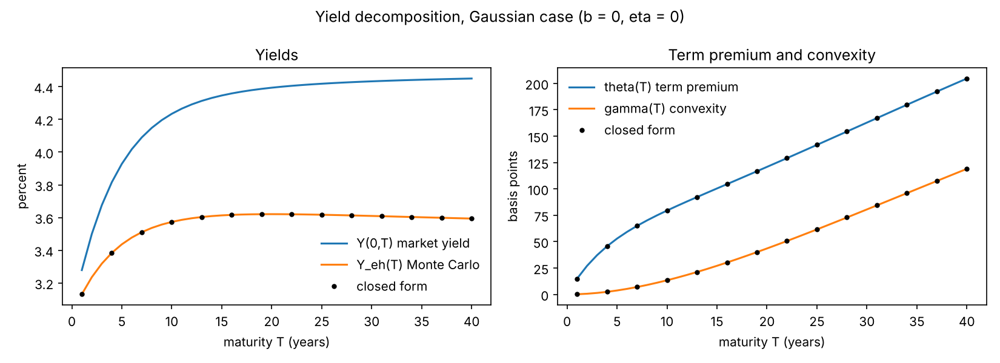
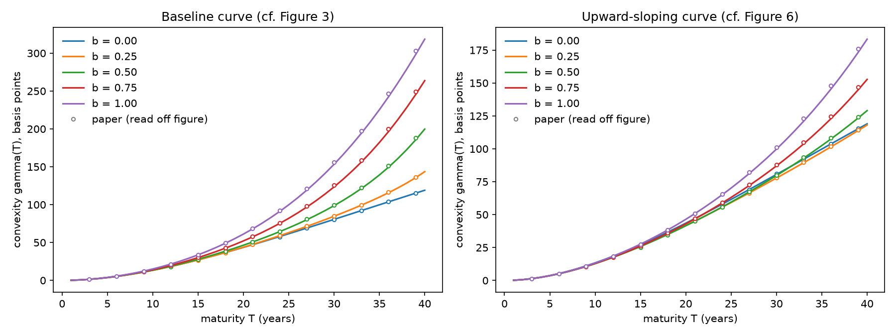
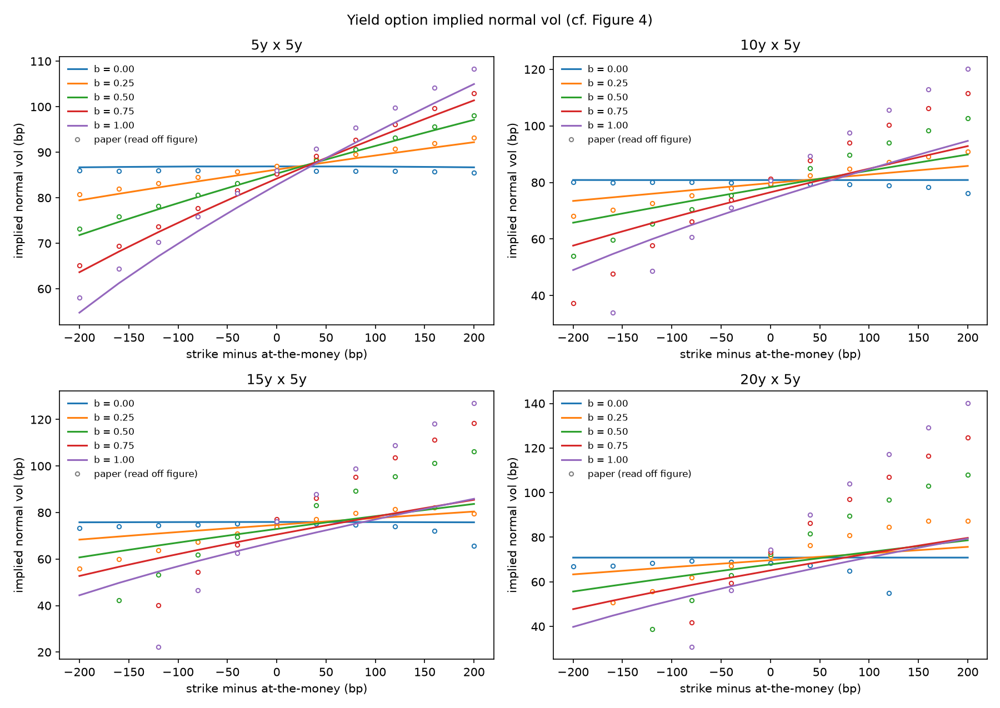
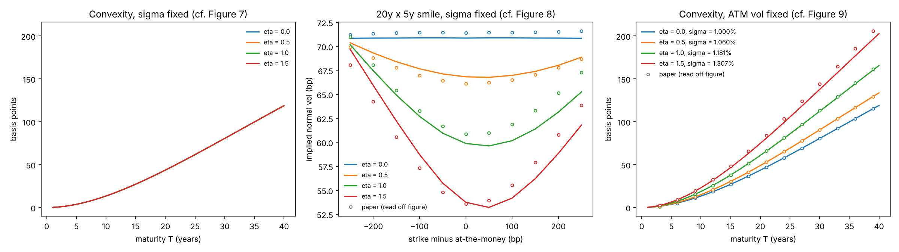
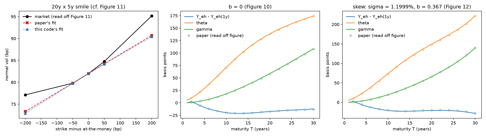
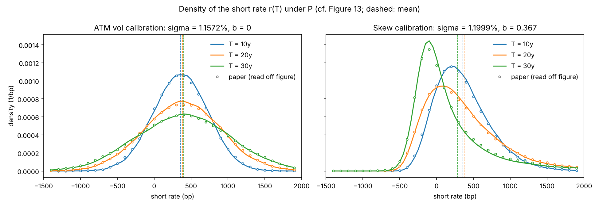

# Against the paper's own numbers

Everything below compares `slidingcurve` with the plotted and printed results
of Piterbarg & Van Der Helm, *Term Premia and Bond Convexity: Sliding Curves,
Trading Strategies, and Model Impact* (6 November 2026). The paper's curves,
smile quotes and plotted results were read off the figure images
(`tools/digitise_figures.py`, accurate to a few tenths of a basis point); the
digitised points are checked against the paper's images in
`investigation/overlay_fig*.png` and are plotted again in
`experiments/digitisation_overlay.py`.

Settings throughout: the Section 9.1 baseline (`delta = 5`, `kappa = 0.03`),
monthly steps for the decomposition, 24 steps a year for pricing, and the
unweighted bootstrap scaling on a monthly expiry grid. Numbers are basis
points unless stated. The runnable demonstrations are in `../examples/`; the
investigation that produced and closed every discrepancy is in
`investigation.md`, and the record of what was put to the authors is in
`questions_for_authors.md`.

## Section 9.1: the Gaussian decomposition

`examples/gaussian_decomposition.py`. Monte Carlo and the closed forms agree
to 0.002bp, and the closed forms reproduce all four series of Figure 2 to
0.24bp (digitisation error) at every maturity from 1 to 40 years.

- Gaussian swaption prices agree with the exact Jamshidian price to within
  Monte-Carlo error (about 0.05bp of normal volatility at 65,536 paths).
- Yield options can be priced with a Gaussian-twin control variate
  (`control_variate=True`): exact in the Gaussian case, so `sigma` for the
  82bp at-the-money vol is 1.1572% at any seed and path count (plain:
  +-0.01% at 32,768 paths), and variance cut 14-28x at the market skew.
- Volatility scaling, 20y caplet on the 5y rate: moving `b` from 0 to 1 moves
  at-the-money volatility by about 10% with forward centring and by under 4%
  with the unweighted bootstrap. The bootstrap is the calibration default.
- With skew and/or stochastic volatility on, the three independently
  estimated terms of `Y = Y_eh + theta - gamma` sum to the market yield to
  within their standard error.

## Section 9.2: skew and convexity (Figures 3 and 6)

`examples/skew_sweep.py`, on the paper's two synthetic curves:

| Convexity at 40y | b = 0 | 0.25 | 0.5 | 0.75 | 1 |
|---|---|---|---|---|---|
| Baseline curve, this code | 119.0 | 143.5 | 199.8 | 263.7 | 318.5 |
| Baseline curve, paper (Figure 3) | 119.0 | 144.1 | 202.1 | 267.6 | 323.3 |
| Steep curve, this code | 119.0 | 118.1 | 129.0 | 152.7 | 183.3 |
| Steep curve, paper (Figure 6) | 119.5 | 118.4 | 129.9 | 154.9 | 186.3 |

The expectations-hypothesis yield of Figures 2 and 5 is matched to within
0.5bp at every maturity. Convexity is matched to within Monte-Carlo error at
low skew and falls 1.7-2.6% short of the paper at `b >= 0.5` and 40 years
(precise runs: 317.2 +- 0.9 against 323.3 at `b = 1`; investigation A2). Part
of the earlier shortfall was numerical: the bootstrap (81) discretises (80)
with a first-order error in its expiry grid, and the annual grid used before
was 3.4bp off on the steep curve at `b = 1`; the default grid is now monthly
(within 0.2bp of converged). The rest sits inside the sensitivity to the
volatility cap of Remark 8, which binds at high skew even without stochastic
volatility: at `b = 1`, moving the cap from 10x to 12x moves `gamma(40y)` by
26bp. The paper does not define the cap precisely enough to go further. The
time step, the curve beyond 40 years and the volatility floor were ruled out.
Forward-centred scaling gives 185bp instead of 320bp at `b = 1`, so the
bootstrap is what the paper's numbers require.

### Figure 4: resolved as a bug in the paper

**Figure 4 (smiles by skew) was a bug in the paper's implied-volatility
calculation**, confirmed by the authors on 16 November 2026; a corrected
version is to be posted and nothing else in the paper changes. The evidence
below is kept as the record of what was measured, and because it is what
identified the bug. `examples/skew_smiles.py` prices the same yield options
that reproduce Section 9.4:

- At the 5y expiry the smile slopes agree. At 10-20y the paper's plotted
  smiles are up to four times steeper than this code's, and its at-the-money
  vol rises with `b` where this code's falls.
- The paper's *text* says at-the-money vol at `b = 1` is about 4bp below its
  `b = 0` value at 5y and 6-8bp below at 20y. This code gives 4.6bp and 9bp:
  it agrees with the text, which Figure 4 itself contradicts.
- Figure 4's `b = 0` smile at 20y droops from 68bp to 55bp, while Figure 8
  shows the same option at `b = 0`, `eta = 0` flat at 71.4bp.
- At `b = 0` the option is Gaussian in every measure, yet Figure 4's 15-20y
  `b = 0` smiles are flat and then fall off a cliff, losing points half a
  standard deviation from the money. No measure, numeraire, inversion
  forward or call/put convention produces that (A1); nor does sampling noise
  through the floor-clipped inversion, at 4,096-16,384 paths over 64 seeds.
- The excess skew had a fingerprint: the paper's `b = 1` smile slope is 1.01,
  2.00, 3.01 and 4.28 times this code's at 5, 10, 15 and 20 years, a factor
  of `T / delta`, while the at-the-money levels agree to about 1bp. The
  volatility cap, the time step and a skew compounded per benchmark period
  are all refuted as its source, and no local volatility in the benchmark
  yield can carry that factor in its slope at the paper's at-the-money
  levels.

Every reading of the option and every scaling and local-volatility variant
was tried (`investigation.md`, A1); none moves the 20y `b = 1` slope off 25bp
against the paper's 110bp. The `T / delta` fingerprint is what pointed at the
implied-volatility calculation, and the authors found the bug there.
`../tests/test_fig4_fingerprint.py` pins the fingerprint, so a pricer change
that compounds the skew per benchmark period fails the suite; it is kept as
that guard, and will be repointed at the corrected figure once it is
published and re-digitised.

## Section 9.3: stochastic volatility (Figures 7-9)

`examples/stochvol_sweep.py`, on the paper's baseline curve with the 20y x 5y
yield option as the benchmark:

| eta | ATM vol at fixed sigma: this code / paper | Convexity at 40y, ATM vol fixed: this code / paper |
|---|---|---|
| 0 | 70.9 / 71.4bp | 119.0 / 119.2bp |
| 0.5 | 66.8 / 66.1bp | 133.7 / 133.6bp |
| 1.0 | 59.9 / 60.9bp | 165.5 / 166.7bp |
| 1.5 | 53.8 / 53.6bp | 202.7 / 212.8bp |

Figure 7 (convexity unchanged by `eta` at fixed `sigma`) is reproduced.
Figure 9 is matched to within 1% up to `eta = 1`; at `eta = 1.5` this code
gives 204.2 +- 1.3bp (four pricing seeds) against 212.8 (A3). The gap is not
the volatility cap (it never binds at `b = 0`), the time step, or the
variance scheme (quadratic-exponential agrees with exact CIR sampling to
0.1bp of at-the-money vol), and recalibrating to the paper's 71.5bp breaks
`eta = 0.5`. The paper's ratios are not squared at-the-money vol ratios
either (that hypothesis fails at `eta = 0.5`). What remains is sampling noise
in the paper's run, which only its path count can confirm.

Figure 8's smiles agree to 0.4-1.5bp, and on a common axis of absolute
strikes their minima coincide (about 400bp; the smile above plots both
against absolute strike). An earlier version of this comparison set this
code's offsets from the yield's mean (364bp) against the paper's offsets from
the forward (387bp), which made the minimum appear 50bp to the right (A4).
The paper's `eta = 0` level, 71.4bp (71.5 in its text), is 0.55bp above the
exact Gaussian value of 70.86bp and its line is tilted, which a Gaussian
smile cannot be under any pricing convention: it looks like the sampling
error of a run with a few thousand paths.

Section 8.2 quotes an uplift of about 15%, 16% and 17.5% for `eta = 0.6` over
ten years at `kappa = 0`, `0.03` and `0.05`. Those are exactly the Jensen
ratio `E(V) / E(sqrt V)^2` of a driftless rate on the CIR clock (14.5%,
16.3%, 17.5%; A5). The full model gives 0.6-0.7 points less (13.85 +- 0.07%
at `kappa = 0`), because the benchmark yield's forward-measure drift is
itself driven by the realised variance; made driftless, the model reproduces
the Jensen ratio to 0.1 points.

## Section 9.4: the market curve (Figures 10-12)

The 21-Aug-2026 USD curve, the five 20y x 5y smile quotes and the paper's
results were also read off the figures. `examples/market_curve.py`:

| | this code | paper |
|---|---|---|
| `sigma` for an 82bp at-the-money vol, `b = 0` | 1.157% | 1.157% |
| Figure 10 at 20y: `Y_eh`, `theta`, `gamma` | 372.6, 138.0, 58.3bp | 372.6, 138.0, 58.3bp |
| Skew fit: `sigma`, `b` | 1.196%, 0.354 | 1.1999%, 0.367 |
| Skew fit vols at -200, -50, 0, +50, +200bp | 72.9, 79.8, 82.0, 84.2, 90.4 | 73.3, 79.8, 82.0, 84.2, 90.7 |
| Figure 12 `gamma` at 30y, paper's parameters | 140.1bp | 140.3bp |
| Figure 12 `gamma` at 30y, this code's fit | 136.8bp | 140.3bp |

Three things to know:

- **The paper states two values of `sigma` for the skew fit**: 1.12% in the
  text of Section 9.4 and 1.1999% in the caption of Figure 13. Only 1.1999%
  reproduces Figure 12 (`gamma(30y)` 140.5 against 140.3bp; 1.12% gives
  115.6) and the paper's fitted smile of Figure 11 (to 0.7bp; 1.12% misses by
  3-5bp under any reading of the option). The text's value is a typo or a
  leftover (A10).
- **The "yield option" is not defined in the paper.** Its numbers pin it down
  (`investigation.md`, A9): the underlying is the continuously compounded
  forward yield (the only one that gives `sigma = 1.1572%`), paid at the end
  of its window (the only payment date that reproduces the paper's own
  Figure 11 fit at its stated parameters), with vols inverted around the
  yield's mean in that measure. Whether strikes are offsets from that mean or
  from the curve forward is not determined: Figure 11 favours the mean,
  Figure 8 the forward. `strike_reference=` offers both; the default is the
  mean.
- **The fit differs slightly from the paper's** (`b` 0.353 against 0.367).
  The paper's own parameters reproduce its plotted fit in this code to
  0.7bp, so the engine agrees; the fit is what moves. Five quotes fix a
  valley in (`sigma`, `b`) along which `gamma(30y)` moves about 10bp per
  basis point of smile level, and over pricing seeds a single fit scatters by
  0.0055% in `sigma`, 0.0027 in `b` and 1.7bp in `gamma(30y)` at 65,536 paths
  (A6). The paper does not state its weights or path count; here the
  at-the-money quote is pinned, since the paper says it is matched exactly.
- **At the end of the plotted range** (30 years on the market curve, 40 on
  the synthetic ones) `Y_eh` and `theta` depend on forwards up to five years
  further out, which no figure shows. Reasonable extensions move `Y_eh(30y)`
  between 370 and 378bp and `theta` by the same amount the other way; the
  paper's values lie inside that band, 1.5bp from this code's quadratic
  extension. Convexity is unaffected (A8).

The three-parameter fit including `eta` is not identified by five quotes at
Monte-Carlo precision (A7). Profiling `eta` (refitting `sigma` and `b` at
each value) the rms error falls monotonically from 2.87bp at `eta = 0` to
1.30bp at 1.6, and beyond 0.8 by less than one quote's pricing s.e. (about
1.3bp), so where a fit stops is set by its random numbers. The paper's point
(1.492%, 0.417, 0.779) and this code's earlier one (1.80%, 0.36, 1.39) lie on
the same valley, along which `gamma(30y)` runs from 137 to 464bp (316 at the
paper's point). The "spurious basin" above `sigma = 2.5%` is the same valley
at larger `eta`. This is the paper's own conclusion in other words.

### Figure 13: short-rate densities

`examples/short_rate_density.py`:

| r(30y) | this code | paper |
|---|---|---|
| Standard deviation, no skew | 638bp | "over 600bp" |
| Probability negative, no skew | 0.27 | "around one in four" |
| Median, with skew | 26bp | "around zero" |
| Probability negative, with skew | 0.47 | "about one half" |
| Mean, with skew | 282bp | 280bp |
